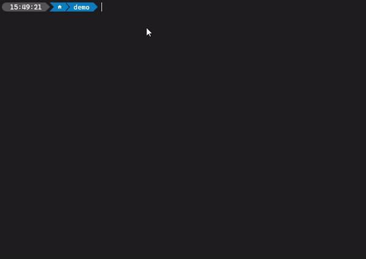

# Introduction

Stream Deck CLI is a command-line interface tool for building, managing, and packaging Stream Deck plugins, and is the quickest way to get up-and-running when developing for Stream Deck.



## Installation

### Prerequisites

- [Node.js](https://nodejs.org/en/download/package-manager) version 24 or higher.
- [Stream Deck](https://www.elgato.com/s/downloads?product=Stream%20Deck) version 7.1 or higher.
- Stream Deck device.

<details>
	<summary>Learn more about installing Node.js.</summary>

Installing Node.js is best achieved with a Node version manager, such as:

- [nvm](https://github.com/nvm-sh/nvm?tab=readme-ov-file#installing-and-updating) for macOS
- [nvm-windows](https://github.com/coreybutler/nvm-windows/releases) for Windows

With one of the aforementioned nvm(-windows) installed, run the following commands:

1. Install Node.js:

   ```bash
   nvm install 24
   ```

2. Switch to the installed version of Node.js:

   ```bash
   nvm use 24
   ```

3. Restart your terminal and verify the version of Node.js is at least version 24:

   ```bash
   node -v
   ```

<Info>
	For more information on installing Node.js on Windows, we recommend Microsoft's how-to [Install Node.js on
	Windows](https://learn.microsoft.com/en-us/windows/dev-environment/javascript/nodejs-on-windows#install-nvm-windows-nodejs-and-npm),
	or Node.js' [download page](https://nodejs.org/en/download/package-manager).
</Info>

</details>

<Tip title="Stream Deck">
	If you do not own a Stream Deck device, you can try [Stream Deck Mobile](https://www.elgato.com/stream-deck-mobile)
	for free.
</Tip>

### Installing from NPM

We recommend installing Stream Deck CLI from [npmjs](https://www.npmjs.com/package/@elgato/cli) using the command:

```bash
npm install -g @elgato/cli@latest
```

<details>
	<summary>PowerShell on Windows</summary>

Node.js CLIs include a local `.ps1` PowerShell script that requires an execution policy to run. If an execution policy is not yet configured, you can set one using [`Set-ExecutionPolicy`](https://learn.microsoft.com/en-us/powershell/module/microsoft.powershell.security/set-executionpolicy), for example:

```bash title="Set PowerShell's execution policy"
Set-ExecutionPolicy -ExecutionPolicy RemoteSigned -Scope CurrentUser
```

</details>

### Verifying

You can verify the installation was successful with the following command:

```bash
streamdeck -v
```

The version of Stream Deck CLI should have printed in your terminal.

<Tip>
	In addition to `streamdeck`, you can also use the shorthand alias `sd`, for example `streamdeck create` and `sd
	create` are the same command.
</Tip>

## Overview

With the Stream Deck CLI installed, you can run `streamdeck` to see an overview of what commands are available. This should look similar to the following.

```
Usage: streamdeck [options] [command]

Options:
  -v                            display CLI version
  -h, --help                    display help for command

Commands:
  create                        Stream Deck plugin creation wizard.
  link [path]                   Links the plugin to Stream Deck.
  restart|r <uuid>              Starts the plugin in Stream Deck; if the plugin is already running, it is stopped first.
  stop|s <uuid>                 Stops the plugin in Stream Deck.
  dev [options]                 Enables developer mode.
  validate [options] [path]     Validates the Stream Deck plugin.
  pack|bundle [options] [path]  Creates a .streamDeckPlugin file from the plugin.
  config                        Manage the local configuration.
  help [command]                display help for command

Alias:
  streamdeck
  sd
```

## What's next?

- Create your first Stream Deck plugin using the [`streamdeck create`](./commands/create.mdx) command.
- Join our wonderful [Marketplace Maker](https://discord.gg/GehBUcu627) Discord community.
