# Plugin Guidelines

The following style guide outlines the guidelines that your Stream Deck plugin's metadata must conform to when publishing on Marketplace. In doing so, it ensures an inclusive, consistent, and good user-experience for Stream Deck users.

On this page, you'll learn more about:

- Guidelines for defining the metadata associated with your plugin.
- Image dimensions and requirements.
- General best practices, such as providing visual feedback.

<Info title="Guideline Compliance">

Elgato reserves the right to request changes to your product to ensure compliance with applicable guidelines. Failure to implement these changes may result in your Marketplace submission being rejected or your product being removed from Marketplace. Elgato also reserves the right to reject any Marketplace submission at its sole discretion, regardless of whether it meets the applicable quality standards.

</Info>

## UUIDs

Universally unique identifiers (UUIDs) are used by Stream Deck and Marketplace to identify:

- Your [plugin](../references/manifest.mdx#manifest-uuid).
- [Actions](../references/manifest.mdx#action-uuid) within your plugin.

<Guidelines type="Requirements">
<Guidelines.Good>

- include author (organization name) and plugin name in your plugin UUID — for example `com.elgato.volume-controller`.
- prefix action UUIDs with your plugin UUID — for example `com.elgato.volume-controller.mute-audio-device`.

</Guidelines.Good>
<Guidelines.Bad>

- change UUIDs after publishing your plugin.

</Guidelines.Bad>
</Guidelines>

<Guidelines type="Recommendations">
<Guidelines.Good>

- reverse DNS format — consider using the format `{DOMAIN}.{PRODUCT}`, for example `com.elgato.wave-link`.
- [`VisibleInActionsList`](../references/manifest.mdx#action-visibleinactionslist) — prefer cloning actions, and hiding older implementations instead of changing action UUIDs.

</Guidelines.Good>
</Guidelines>

## Plugin

### Name

Your plugin's name is a word, or short phrase, that uniquely identifies your plugin and the functionality it provides.

<Guidelines type="Requirements">
<Guidelines.Good>

- use a unique name — check your name is available on [Marketplace](https://marketplace.elgato.com/stream-deck/plugins).
- accurately reflect the functionality provided by your plugin.

</Guidelines.Good>
<Guidelines.Bad>

- infringe copyright or trademarks.
- use derogatory or offensive vocabulary.

</Guidelines.Bad>
</Guidelines>

<Guidelines type="Recommendations">
<Guidelines.Good>

- descriptive and concise — for example "Volume Controller", "Screen Capture", "Color Picker", etc.
- memorable and easy to pronounce.

</Guidelines.Good>
<Guidelines.Bad>

- organization name — avoid including your organization name in your plugin's name; organization is already visible on Marketplace.

</Guidelines.Bad>
</Guidelines>

### Author

The [`Author`](../references/manifest.mdx#manifest-author) field within the manifest uniquely identifies you, or your organization, as the creator of the plugin, and is visible within Marketplace and Stream Deck.

<Guidelines type="Requirements">
<Guidelines.Good>

- use your Marketplace organization name.
- use company name where applicable — for example "Elgato".
- use your real name, if you wish too — for example "Jane Doe".
- use your online alias, if you wish too — for example "jdodo".

</Guidelines.Good>
<Guidelines.Bad>

- infringe copyright or trademarks.
- use derogatory or offensive vocabulary

</Guidelines.Bad>
</Guidelines>

### Icon

Your plugin's [icon](../references/manifest.mdx#manifest-icon), visible within Stream Deck preferences pane, must adhere to the following guidelines.

#### Sizing

<figure>

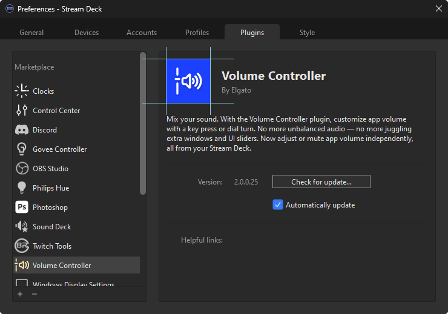

<figcaption>Plugin icon, 256 × 256 px and 512 × 512 px (high DPI).</figcaption>

</figure>

<Guidelines type="Requirements">
<Guidelines.Good>

- use PNG format.
- accurately portray what your plugin does.

</Guidelines.Good>
<Guidelines.Bad>

- infringe copyright.
- use offensive imagery.

</Guidelines.Bad>
</Guidelines>

## Actions List

### Naming

Your plugin's [category](../references/manifest.mdx#manifest-category) and [action names](../references/manifest.mdx#action-name) must accurately represent their functionality, and be sufficiently descriptive but concise (approximately 30 characters or less).

<figure>

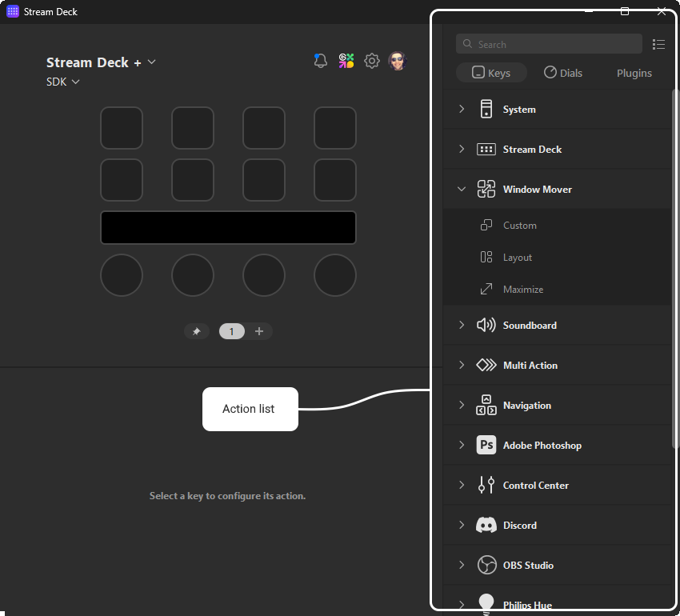

</figure>

<Guidelines type="Requirements">
<Guidelines.Good>

- specify the [category](../references/manifest.mdx#manifest-category).
- use the same, or similar, values for plugin [name](../references/manifest.mdx#manifest-name) and [category](../references/manifest.mdx#manifest-category).

</Guidelines.Good>
<Guidelines.Bad>

- include author names in category, for example "Camera Controls (John Doe)".
- use derogatory or offensive vocabulary.

</Guidelines.Bad>
</Guidelines>

<Guidelines type="Recommendations">
<Guidelines.Good>

- specify action [tooltips](../references/manifest.mdx#action-tooltip).
- "Volume Controller", "Mute Audio Device" — descriptive and concise names.
- "Twitch Mod Controls" — descriptive without infringing copyright exclusivity.

</Guidelines.Good>
<Guidelines.Bad>

- "Moderator Controls for Streaming" — too vague, and more than 30 characters.
- "Toggle Chat Mode And Send Message" — should be two separate actions.
- "Elgato Wave Link" — omit organization when also the author, prefer "Wave Link".

</Guidelines.Bad>
</Guidelines>

### Icons

[Category](../references/manifest.mdx#manifest-categoryicon) and [action](../references/manifest.mdx#action-icon) icons within the action list supports both vectorized (SVG) and rasterized (PNG) image files, with SVG being the recommended format to provide optimal scaling.

#### Sizing

<figure>

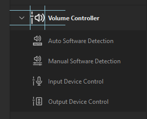

<figcaption>Category icon, 28 × 28 px — and 56 × 56 px (high DPI) when using rasterized images.</figcaption>

</figure>

<figure>

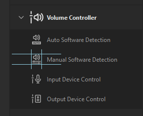

<figcaption>Action icon, 20 × 20 px — and 40 × 40 px (high DPI) when using rasterized images.</figcaption>

</figure>

<Guidelines type="Requirements">
<Guidelines.Good>

- use SVG or PNG format.
- use monochromatic color scheme, with a transparent background.
- provide high-DPI variants when using rasterized images (PNG).
- use white stroke, `#FFFFFF`, for action list icons.

<figure>

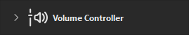

<figcaption>Good — Monochromatic category icon with white stroke.</figcaption>

</figure>

<figure>

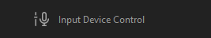

<figcaption>Good — Monochromatic action icon with white stroke; auto-adjusted by Stream Deck.</figcaption>

</figure>

</Guidelines.Good>
<Guidelines.Bad>

- use colors to style action list icons.

<figure>

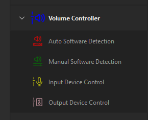

<figcaption>Bad — Action lists icons with color.</figcaption>

</figure>

- use solid backgrounds on action list icons.

<figure>

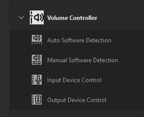

<figcaption>Bad — Action list icons with a solid background.</figcaption>

</figure>

</Guidelines.Bad>
</Guidelines>

<Guidelines type="Recommendations">
<Guidelines.Good>

- SVG — scale well on all devices and layouts.

</Guidelines.Good>
<Guidelines.Bad>

- PNG — rasterized images may not scale well.

</Guidelines.Bad>
</Guidelines>

### Grouping

When determining the actions provided by your plugin, you should aim to provide an array of functionality that adds value to your plugin, without overwhelming the user.

<Guidelines type="Recommendations">
<Guidelines.Good>

- combine actions — actions with common settings should be consolidated, and have a property inspector for configuring them.

<figure>

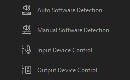

<figcaption>Good — Consolidate actions that share settings</figcaption>

</figure>

- provide a reasonable amount of functionality, between 2 and 30 actions, no more.

</Guidelines.Good>
<Guidelines.Bad>

- avoid static actions that aren't configurable.

<figure>

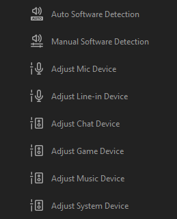

<figcaption>Bad — Avoid static actions</figcaption>

</figure>

</Guidelines.Bad>
</Guidelines>

## Key Icons

[Key icons](../references/manifest.mdx#state-image), represented as state images within the manifest, can be vectorized (SVG) or rasterized (PNG) images, with SVG being the recommended format to provide optimal scaling.

In addition to static images, animated (GIF) images may also be specified within the manifest, but cannot be used when programmatically updating actions.

### Sizing

<figure>

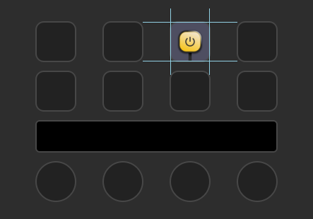

<figcaption>Key icon, 72 × 72 px — and 144 × 144 px (high DPI) when using rasterized images.</figcaption>

</figure>

<Info title="Updating programmatically">

When updating key icons programmatically only one image size can be supplied. For rasterized images, it is recommended to provide an image that uses the higher DPI dimensions; Stream Deck will scale the image down accordingly.

</Info>

<Guidelines type="Requirements">
<Guidelines.Good>

- use SVG, PNG, or GIF format.
- use [states](../references/manifest.mdx#state-image) effectively — update icons when a state associated with the action changes, for example the associated smart light is turned on / off.

</Guidelines.Good>
</Guidelines>

<Guidelines type="Recommendations">
<Guidelines.Good>

- SVG — vectorized images allow you to provide visually appealing dynamic keys, for example charts and meters.
- positional awareness — consider grouping actions based on their coordinates to provide new levels of interactions.

<figure>

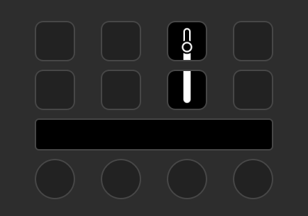

<figcaption>
	Good — Volume Controller's action act as an interactive slider when actions are paired together.
</figcaption>

</figure>

</Guidelines.Good>
<Guidelines.Bad>

- programmatic flooding — keys are not intended for rendering high frame rate videos; limit programmatic calls to a _maximum_ of 10 per second.

</Guidelines.Bad>
</Guidelines>

## Layouts

Touch strip [layouts](../guides/dials.mdx#layouts) found on Stream Deck + support providing rich feedback in the form of elements, and allow for touch and hold interaction. The following should be considered when using layouts.

### Sizing

<figure>

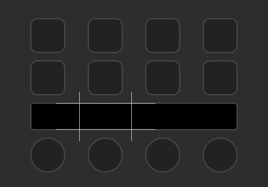

<figcaption>Touch strip layout, 200 × 100 px</figcaption>

</figure>

<Danger title="Layout boundary">

All elements within a layout must be within the bounds of the layout; if an element exceeds the bounds, the layout will fail to load.

</Danger>

<Guidelines type="Requirements">
<Guidelines.Good>

- use accessible touch size — interactive elements should be accessible, and have a touch size of at least 35 × 35 px.

</Guidelines.Good>
</Guidelines>

<Guidelines type="Recommendations">
<Guidelines.Good>

- [built-in layouts](../guides/dials.mdx#built-in-layouts) — where suitable, consider using pre-defined layouts.
- partial updates — utilize elements effectively to update portions of layouts.
- responsive — elements should update promptly when the state associated with the

</Guidelines.Good>
<Guidelines.Bad>

- lots of touchable elements — space on the touch strip is limited, and cramped elements can be difficult for users with accessibility requirements.
- programmatic flooding — touch strips are not intended for rendering high frame rate videos; limit programmatic calls to a _maximum_ of 10 per second.

</Guidelines.Bad>
</Guidelines>

## Temporary Feedback

Stream Deck SDK enables your plugin to provide feedback to the user when an action (or operation) succeeds or fails.

<Guidelines type="Requirements">
<Guidelines.Good>

- use [`showAlert`](../guides/keys.mdx#showalert) to inform the user when an action was unsuccessful. Also applicable to [dials](../guides/dials.mdx#showalert).

</Guidelines.Good>
</Guidelines>

<Guidelines type="Recommendations">
<Guidelines.Good>

- use [`showOk`](../guides/keys.mdx#showok) to inform the user of success when there is no visual indicator, for example a file was written or request was sent.

</Guidelines.Good>
<Guidelines.Bad>

- duplicate success indicators — for actions that have visual indication of success, for example a light changing and the action's state updating, `showOk` is unnecessary.

</Guidelines.Bad>
</Guidelines>

<Tip title="Logging">

Use [logging](../guides/logging.mdx) to record information, specifically when issues occur, to assist with diagnosing potential problems.

</Tip>

## Property Inspectors (UI)

Property inspectors within your Stream Deck plugin play an integral role in allowing users to configure and customize your plugin's actions. Property inspectors must adhere to the following guidelines.

<Guidelines type="Requirements">
<Guidelines.Good>

- use checkbox for boolean settings.
- use select or radio for single-select settings.
- provide validation feedback.
- automatically save settings on change.
- provide setup help — where necessary, provide links to support pages.

</Guidelines.Good>
<Guidelines.Bad>

- include donation or sponsor links — prefer "Additional Links" in your product's page on Marketplace.
- list copyright — prefer description, or "Additional Links", in your product's page on Marketplace.
- have a "Save" button for action settings.

</Guidelines.Bad>
</Guidelines>

<Guidelines type="Recommendations">
<Guidelines.Good>

- hidden by default — to prevent flickering, when using a single property inspector file, hide components by default, and show only necessary components on DOM ready.

</Guidelines.Good>
<Guidelines.Bad>

- complex configuration — avoid using _"lots"_ of components; prefer splitting the action into smaller actions if necessary.
- large paragraphs — space is limited, and should be reserved for configuration.

</Guidelines.Bad>
</Guidelines>
