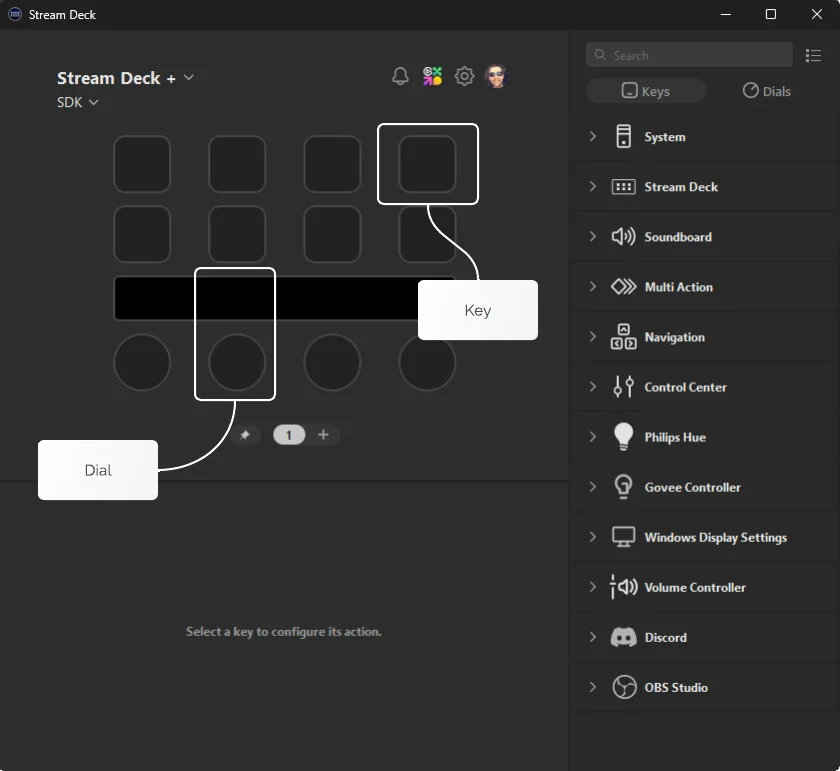
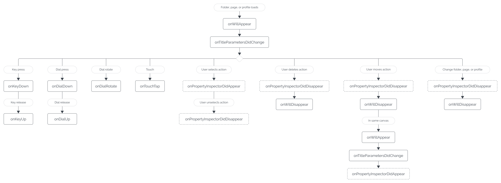

# Actions

Actions represent the core functionality provided by your plugin, and are fundamental to all Stream Deck plugins. All interactive physical elements found on a Stream Deck device, for example keys, dials, pedals, etc. are all associated with actions, allowing users to execute your plugin's functionality.

Examples of actions include:

- Volume control - Wave Link, Volume Controller, Discord, etc.
- Turning a light on/off - Control Center, Hue, Govee, etc.
- Controlling music playback - Spotify, Sound Deck, etc.

## Types of Actions

There are three Stream Deck action types, also referred to as "controllers", these are:

- Key - Includes standard Stream Deck keys (buttons), pedals, G-Keys, etc.
- Dial - A dial and a portion of the touchscreen, found on Stream Deck&nbsp;+.
- Neo Infobar - An informational action for Stream Deck Neo.



> [!TIP]
> **Supporting action controllers**
>
> Your plugin can specify which controllers are supported by each action as part of the [action's metadata](#metadata), allowing the user to assign the action to either a key and/or a dial (aka an encoder).

## Action Identifiers

Actions are uniquely identified by their UUID, which is a reverse DNS formatted string that is defined by you, the plugin's author. The UUID of an action must be prefixed by your plugin's UUID. For example:

> If your plugin's UUID is `com.elgato.hello-world`, and your plugin has a "Counter" action, your action's UUID would be `com.elgato.hello-world.counter`.

Similar to your plugin's UUID, action UUIDs must only contain lowercase alphanumeric characters (`a-z`, `0-9`), hyphens (`-`), and periods (`.`).

> [!WARNING]
> **Do not change UUIDs**
>
> Once defined and published, UUIDs must never change. Actions on a Stream Deck canvas are identified by the plugin and action UUIDs at the time of the user adding the action to the canvas. Changing either of these UUIDs will result in the action(s) being removed from the user's configuration which can cause confusion and frustration.

## Registering Actions

Actions provided by your plugin are registered in two parts:

1. The metadata; stored in your plugin's manifest JSON file.
1. The implementation; registered in the application-layer.

### Metadata

The metadata of your action tells Stream Deck about your action, including:

- The action's name, description, etc.
- Which types of controllers are supported (for example keys, dials, or Neo Infobar).
- How your action is displayed to the user in the actions list.

Metadata associated with your plugin's actions are stored within your plugin's manifest as entries within the `Actions` property. Below is an example of a "Counter" action's metadata in a manifest.

<!-- snippet: json/manifest.json -->

```json title='Example of "Actions" within the manifest JSON file' {7-21}
{
    "$schema": "https://schemas.elgato.com/streamdeck/plugins/manifest.json",
    "UUID": "com.elgato.hello-world",
    "Name": "Hello World",
    "Version": "0.1.0.0",
    "Author": "Elgato",
    "Actions": [
        {
            "Name": "Counter",
            "UUID": "com.elgato.hello-world.increment",
            "Icon": "static/imgs/actions/counter/icon",
            "Tooltip": "Displays a count, which increments by one on press.",
            "Controllers": ["Keypad"],
            "States": [
                {
                    "Image": "static/imgs/actions/counter/key",
                    "TitleAlignment": "middle"
                }
            ]
        }
    ],
    "Category": "Hello World",
    "CategoryIcon": "static/imgs/plugin/category-icon",
    "CodePath": "bin/plugin.js",
    "Description": ".",
    "Icon": "static/imgs/plugin/marketplace",
    "SDKVersion": 2,
    "Software": {
        "MinimumVersion": "6.6"
    },
    "OS": [
        {
            "Platform": "mac",
            "MinimumVersion": "10.15"
        },
        {
            "Platform": "windows",
            "MinimumVersion": "10"
        }
    ],
    "Nodejs": {
        "Version": "20",
        "Debug": "enabled"
    },
    "ApplicationsToMonitor": {
        "mac": ["com.elgato.WaveLink"],
        "windows": ["Elgato Wave Link.exe"]
    },
    "Profiles": [
        {
            "Name": "My Cool Profile",
            "DeviceType": 0,
            "Readonly": false,
            "DontAutoSwitchWhenInstalled": false,
            "AutoInstall": true
        }
    ]
}
```

> [!TIP]
> **Hiding actions**
>
> Actions defined within the manifest will be visible to the user in the actions list in the Stream Deck app. You can hide specific actions from the user by setting `VisibleInActionsList` to `false` in the manifest. Your plugin can utilize its own hidden (or visible) actions as part of pre-configured [profiles](./profiles.md) bundled with your plugin. Hiding actions is also useful for deprecating older actions, without completely removing them.

> [!NOTE]
> **Action icons**
>
> Learn more about creating icons for your plugin as part of our [UX guidelines for the actions list](https://docs.elgato.com/guidelines/stream-deck/plugins).

### Implementation

With your action's metadata defined within the manifest, it is then the responsibility of your plugin's application-layer to provide the implementation, i.e. what your action does when a user interacts with Stream Deck

Actions are represented as single-instance classes that inherit from a `SingletonAction`. Your action's class then overrides methods to handle events from Stream Deck, for example:

<!-- snippet: node/guides/actions/actions/log-key-press.ts -->

```ts title="Action class demonstrating the key down event"
import streamDeck, { action, type KeyDownEvent, SingletonAction } from "@elgato/streamdeck";

/**
 * An action that logs a Stream Deck key press.
 */
@action({ UUID: "com.elgato.hello-world.log" })
export class LogKeyPressAction extends SingletonAction {
	/**
	 * Handles the user pressing a Stream Deck key (pedal, G-key, etc).
	 * @param ev Information about the event.
	 */
	override onKeyDown(ev: KeyDownEvent): void | Promise<void> {
		streamDeck.logger.info(`Key pressed!`);
	}
}
```

Once implemented, your plugin must register the action in the entry file of the application-layer:

<!-- snippet: node/guides/actions/register.ts -->

```ts title="Registering actions within the plugin" {5}
import streamDeck from "@elgato/streamdeck";

import { LogKeyPressAction } from "./actions/log-key-press";

streamDeck.actions.registerAction(new LogKeyPressAction());
streamDeck.connect();
```

> [!TIP]
> **Order of execution**
>
> It is important to register all of your plugin's actions before connecting to Stream Deck. As a general rule of thumb, it is recommended to call `streamDeck.connect()` last in the entry file of your plugin.

> [!NOTE]
> **User interfaces**
>
> In addition to an action's Node.js implementation, actions can also have a user interface. More commonly referred to as property inspectors, these user interfaces can allow users to configure the settings associated with your action directly within Stream Deck. Learn more about the [architecture of plugins](../introduction/plugin-environment.md#javascript-runtimes), [settings](./settings.md), and [property inspectors](./ui.md).

## Handling Events

Events are used extensively throughout the Stream Deck SDK, and allow your plugin to react to user interaction on both a hardware and software level.

The diagram below provides an overview of events relating to actions, and their order of invocation. The events emitted are based loosely on how your action is configured, for example property inspector (UI) events will not be emitted for an action that does not have a property inspector associated with it; these events are highlighted with a dashed border.



The `SingletonAction` class, that your actions inherit from, contains virtual methods that your class should implement to handle events from Stream Deck, for example `onKeyDown`, `onDialRotate`, `onWillAppear`, etc.

When an event handler is invoked on your action, the event information is supplied as a parameter to provide context, for example:

<!-- snippet: node/guides/actions/events.ts -->

```ts title="Callback functions are provided with an event parameter" {17-19}
import streamDeck, { action, type KeyDownEvent, SingletonAction, type WillAppearEvent } from "@elgato/streamdeck";

/**
 * An action that logs a key press.
 */
@action({ UUID: "com.elgato.hello-world.log" })
export class LogKeyPressAction extends SingletonAction {
	/**
	 * Handles the action appearing on the canvas.
	 * @param ev Information about the event.
	 */
	override onWillAppear(ev: WillAppearEvent): void | Promise<void> {
		ev.action; // instance of the action the event is for.
		ev.action.device; // device information.
		ev.payload.controller; // type of the action, i.e. key, or dial & touchscreen.

		// etc.
	}

	/**
	 * Handles the user pressing a Stream Deck key (pedal, G-key, etc).
	 * @param ev Information about the event.
	 */
	override onKeyDown(ev: KeyDownEvent): void | Promise<void> {
		streamDeck.logger.info(`Key pressed!`);
	}
}
```

> [!TIP]
> **Settings**
>
> You can [persist settings on actions](./settings.md); these settings are provided as part of event arguments and can be accessed via `ev.payload.settings`.

## Accessing Visible Actions

Your plugin's actions visible on Stream Deck can also be accessed outside of events, allowing you to retrieve information about them and update their appearance. This can be useful, for example, when your plugin has processed a background task and needs to update the actions shown on Stream Deck asynchronously.

Accessing your plugin's visible actions can be achieved in the following ways:

<!-- snippet: node/guides/actions/visible-actions.ts -->

```ts title="Visible Actions" {4-7}
import streamDeck from "@elgato/streamdeck";

// Iterate over all of your plugin's visible actions.
streamDeck.actions.forEach((action) => {
	if (action.isKey() || action.isDial()) {
		action.setTitle("Hello world");
	}
});
```

<!-- snippet: node/guides/actions/visible-actions-of-type.ts -->

```ts title="Visible Actions of Type" {13-17}
import { action, KeyDownEvent, SingletonAction } from "@elgato/streamdeck";

/**
 * Example of accessing the visible actions of a specific action type.
 */
@action({ UUID: "com.elgato.hello-world.increment" })
export class IncrementCounter extends SingletonAction {
	/**
	 * Occurs when the user presses the key.
	 */
	override onKeyDown(ev: KeyDownEvent) {
		// Iterate over visible actions with the UUID "com.elgato.hello-world.increment".
		this.actions.forEach((action) => {
			if (action.isKey() || action.isDial()) {
				action.setTitle("Hello world!");
			}
		});
	}
}
```

> [!NOTE]
> Please note, it is not possible to access or control actions that are not owned by your plugin.

## Events

The following events are found on the `SingletonAction` class, and apply to keys, dials, and Neo Infobar actions.

<!-- generated: actions-events -->

### onDidReceiveResources

Occurs when the resources are updated within the property inspector.

```ts
function onDidReceiveResources(ev: DidReceiveResourcesEvent): void | Promise<void>
```

**Parameters**

| Name | Type | Description |
| --- | --- | --- |
| `ev` | `DidReceiveResourcesEvent` | Function to be invoked when the event occurs. |

### onDidReceiveSettings

Occurs when the settings are updated within the property inspector.

When `streamDeck.settings.useLegacySettingsBehavior` is set to `true`, this also fires after
calling `getSettings()`.

```ts
function onDidReceiveSettings(ev: DidReceiveSettingsEvent): void | Promise<void>
```

**Parameters**

| Name | Type | Description |
| --- | --- | --- |
| `ev` | `DidReceiveSettingsEvent` | Information about the event, including the source action and contextual payload information. |

### onPropertyInspectorDidAppear

Occurs when the property inspector associated with the action becomes visible, i.e. the user selected an action in the Stream Deck application. See also `streamDeck.ui.onDidAppear`.

```ts
function onPropertyInspectorDidAppear(ev: PropertyInspectorDidAppearEvent): void | Promise<void>
```

**Parameters**

| Name | Type | Description |
| --- | --- | --- |
| `ev` | `PropertyInspectorDidAppearEvent` | Information about the event, including the source action. |

### onPropertyInspectorDidDisappear

Occurs when the property inspector associated with the action becomes invisible, i.e. the user unselected the action in the Stream Deck application. See also `streamDeck.ui.onDidDisappear`.

```ts
function onPropertyInspectorDidDisappear(ev: PropertyInspectorDidDisappearEvent): void | Promise<void>
```

**Parameters**

| Name | Type | Description |
| --- | --- | --- |
| `ev` | `PropertyInspectorDidDisappearEvent` | Information about the event, including the source action. |

### onSendToPlugin

Occurs when a message was sent to the plugin _from_ the property inspector. The plugin can also send messages _to_ the property inspector using `streamDeck.ui.sendToPropertyInspector`.

```ts
function onSendToPlugin(ev: SendToPluginEvent): void | Promise<void>
```

**Parameters**

| Name | Type | Description |
| --- | --- | --- |
| `ev` | `SendToPluginEvent` | Information about the event, including the source action and contextual payload information. |

### onTitleParametersDidChange

Occurs when the user updates an action's title settings in the Stream Deck application.

```ts
function onTitleParametersDidChange(ev: TitleParametersDidChangeEvent): void | Promise<void>
```

**Parameters**

| Name | Type | Description |
| --- | --- | --- |
| `ev` | `TitleParametersDidChangeEvent` | Information about the event, including the source action and contextual payload information. |

### onWillAppear

Occurs when an action appears on the Stream Deck due to the user navigating to another page, profile, folder, etc. This also occurs during startup if the action is on the "front
page". An action refers to _all_ types of actions, e.g. keys, dials,

```ts
function onWillAppear(ev: WillAppearEvent): void | Promise<void>
```

**Parameters**

| Name | Type | Description |
| --- | --- | --- |
| `ev` | `WillAppearEvent` | Information about the event, including the source action and contextual payload information. |

### onWillDisappear

Occurs when an action disappears from the Stream Deck due to the user navigating to another page, profile, folder, etc. An action refers to _all_ types of actions, e.g. keys,
dials, touchscreens, pedals, etc.

```ts
function onWillDisappear(ev: WillDisappearEvent): void | Promise<void>
```

**Parameters**

| Name | Type | Description |
| --- | --- | --- |
| `ev` | `WillDisappearEvent` | Information about the event, including the source action and contextual payload information. |

<!-- /generated -->

## Commands

The following commands are available to all actions.

<!-- generated: actions-commands -->

### getResources

Gets the resources (files) associated with this action; these resources are embedded into the action when it is
exported, either individually, or as part of a profile.

Available from Stream Deck 7.1.

```ts
function getResources(): Promise<Resources>
```

### getSettings

Gets the settings associated this action instance.

```ts
function getSettings(): Promise<TSettings>
```

### isDial

Determines whether this instance is a dial.

```ts
function isDial(): boolean
```

### isKey

Determines whether this instance is a key.

```ts
function isKey(): boolean
```

### isNeoInfobar

Determines whether this instance is an Infobar.

```ts
function isNeoInfobar(): boolean
```

### setResources

Sets the resources (files) associated with this action; these resources are embedded into the action when it is
exported, either individually, or as part of a profile.

Available from Stream Deck 7.1.

```ts
function setResources(resources: Resources): Promise<void>
```

**Parameters**

| Name | Type | Description |
| --- | --- | --- |
| `resources` | `Resources` | The resources as a map of file paths. |

### setSettings

Sets the settings associated with this action instance.

```ts
function setSettings(value: TSettings): Promise<void>
```

**Parameters**

| Name | Type | Description |
| --- | --- | --- |
| `value` | `TSettings` | Settings to persist. |

<!-- /generated -->
