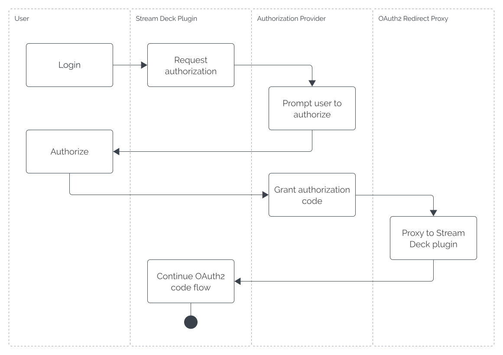

# Deep-Linking

Deep-linking is the process of sending messages to local apps via custom URL scheme registered on the user's device, for example a computer or mobile phone. This can be useful when:

- Handling callbacks from an authorization provider (OAuth2).
- Configuring a local IPC between two local apps.
- Receiving settings from a separate integration.

Stream Deck SDK streamlines the process of deep-linking by providing plugins with a unique URL that allows them to receive deep-link messages under the pre-registered `streamdeck://` scheme.

## Receiving Messages

Handling inbound deep-link messages can be achieved with the `onDidReceiveDeepLink` event handler found in the `system` namespace, for example:

<!-- snippet: node/guides/deep-linking/handler.ts -->

```ts title="Deep-link event callback" {3-5}
import streamDeck from "@elgato/streamdeck";

streamDeck.system.onDidReceiveDeepLink((ev) => {
	// Handle the deep-link message
});

streamDeck.connect();
```

With a handler function registered, your plugin is now set up to receive deep-link messages.

### Deep-Link URL

Each plugin has a unique URL based on their unique identifier using the following format:

```text
streamdeck://plugins/message/<PLUGIN_UUID>
```

With this URL, the plugin is able to receive inbound deep-link messages in the form of a URL that follows the [RFC-3986](https://datatracker.ietf.org/doc/html/rfc3986#section-3) structure:

```text
streamdeck://plugins/message/<PLUGIN_UUID>[path]["?" query]["#" fragment]
```

For example:

```text
                                                              href
                                                   ┌───────────┴───────────┐
streamdeck://plugins/message/com.elgato.hello-world/hello?name=Elgato#waving
                                                   └─┬──┘ └────┬────┘ └─┬──┘
                                                    path      query    fragment
```

### Active vs Passive

By default, when your plugin receives a deep-link message, Stream Deck's window is brought to the foreground. These are referred to as active deep-links, and are useful in scenarios such as OAuth, when you want the user to continue a flow in Stream Deck.

```txt title="Example of an active deep-link"
streamdeck://plugins/message/com.elgato.hello-world/hello
```

From Stream Deck 7.0, it is also possible to send deep-link messages whereby Stream Deck's window is _not_ brought to the foreground. These are referred to as passive deep-links, and are useful in scenarios such as setup operations. For example, sending the port of a local WebSocket server from your app to your plugin so that they can communicate.

To a receive deep-link message as a passive message, you must specify the query string parameter `streamdeck=hidden` within your deep-link URL, for example:

```txt title="Example of a passive deep-link"
streamdeck://plugins/message/com.elgato.hello-world/hello?streamdeck=hidden
                                                          └───────┬───────┘
                                                          Passive deep-link
```

Below is a summary of the differences between active and passive deep-links.

|                                   | Active             | Passive            |
| --------------------------------- | ------------------ | ------------------ |
| Default                           | Yes                | No                 |
| Stream Deck version               | 6.5 or higher      | 7.0 or higher      |
| Stream Deck brought to foreground | Yes                | No                 |
| `streamdeck` query string value   | -                  | `hidden`           |
| OAuth                             | ✅ Recommended     | ❌ Not recommended |
| Setup messages requiring user     | ✅ Recommended     | ❌ Not recommended |
| Setup messages not requiring user | ❌ Not recommended | ✅ Recommended     |

### Example

Given the following event handler:

<!-- snippet: node/guides/deep-linking/example.ts -->

```ts title="Reading a deep-link message" {4-7}
import streamDeck from "@elgato/streamdeck";

streamDeck.system.onDidReceiveDeepLink((ev) => {
	const { path, fragment } = ev.url;

	streamDeck.logger.info(`Path = ${path}`);
	streamDeck.logger.info(`Fragment = ${fragment}`);
});

streamDeck.connect();
```

To send a message to the plugin with the unique identifier `com.elgato.hello-world`, you would submit the following URL:

```text
streamdeck://plugins/message/com.elgato.hello-world/Hello%20world#Testing
```

Which would then log the following:

```text
Path = /Hello%20world
Fragment = Testing
```

Information on the event is parsed from the deep-link URL using the native [URL](https://developer.mozilla.org/en-US/docs/Web/API/URL) API, with the unique prefix ignored, i.e. `streamdeck://plugins/message/<PLUGIN_UUID>`.

<Tip>
  **Testing deep-links**

  To test deep-linking, enter the URL in your browsers URL bar and press return. Alternatively, on Windows you can submit the URL directly in the Run panel, opened with <kbd>Win</kbd> + <kbd>R</kbd>.
</Tip>

## Known Limitations

- Some authorization providers do not accept custom URL schemes as a callback URL. If this is the case, consider using the [OAuth2 redirect proxy](#oauth2-redirect-proxy).
- Keep deep-link messages small (under 2,000 characters). If you need to transfer more data, consider using a WebSocket connection.
- Deep-links are only accessible locally, and it is therefore not possible to receive deep-link messages from remote sources.

## OAuth2 Redirect Proxy

<Warning>
  The OAuth2 redirect proxy is designed to assist with OAuth2 code grant flow for authorization providers that do not accept custom schemes as part of their callback URLs, for example `streamdeck://`.

  It is recommended you use your plugin's deep-link URL as the callback URL unless absolutely necessary.
</Warning>

The OAuth2 redirect proxy is a remotely accessibly `https://` URL that has the single responsibility of forwarding messages to Stream Deck plugins via deep-linking. Due to the sensitive nature of the redirect proxy, no information sent to the proxy is stored on Elgato servers.

The following diagram provides an overview of the flow:



### Redirect URL

The redirect URL follows a similar structure to the [deep-link URL](#deep-link-url), and is uniquely identifiable based on your plugin's identifier. This unique URL should be supplied to the authorization provider as the callback URL when authenticating with OAuth2. The format is as follows:

```text
https://oauth2-redirect.elgato.com/streamdeck/plugins/message/<PLUGIN_UUID>
```

Upon receiving a callback from an authorization provider, the request is forwarded to your plugin. Please note, only a subset of query parameters are forwarded when present, these are:

| Query Parameter | Description                                                     |
| --------------- | --------------------------------------------------------------- |
| `code`          | Authorization code to exchange for an access token.             |
| `state`         | Optional value supplied as part of requesting authorization.    |
| `scope`         | Specifies the level of access that was granted to the app.      |
| `error`         | Error returned by the authorization provider when unsuccessful. |

## URL Builder

The deep-link and OAuth2 redirect proxy URLs for a plugin follow the formats below; replace `<PLUGIN_UUID>` with your plugin's unique identifier, and `<PATH>` with an optional path.

```text title="Deep-link URL"
streamdeck://plugins/message/<PLUGIN_UUID>/<PATH>
```

```text title="OAuth2 redirect proxy URL"
https://oauth2-redirect.elgato.com/streamdeck/plugins/message/<PLUGIN_UUID>/<PATH>
```

For example, the plugin `com.elgato.hello-world` with the path `auth` would use:

```text title="Deep-link URL"
streamdeck://plugins/message/com.elgato.hello-world/auth
```

```text title="OAuth2 redirect proxy URL"
https://oauth2-redirect.elgato.com/streamdeck/plugins/message/com.elgato.hello-world/auth
```

```text title="OAuth2 redirect proxy URL (encoded)"
https%3A%2F%2Foauth2-redirect.elgato.com%2Fstreamdeck%2Fplugins%2Fmessage%2Fcom.elgato.hello-world%2Fauth
```
