# Devices

The Stream Deck SDK provides a list of available Stream Deck devices.

<!-- snippet: node/guides/devices/available-devices.ts -->

```ts title="Array of available devices" {3}
import streamDeck from "@elgato/streamdeck";

streamDeck.devices.forEach((device) => {
	const { id, isConnected, name, size, type } = device;

	streamDeck.logger.info(name); // Stream Deck Neo, Stream Deck +
});
```

## Device Types

Within the Stream Deck SDK, devices are referenced against an enumeration of known devices; these devices, and their associated values, are as follows:

| Device Type | Device(s)                                                                          |
| ----------- | ---------------------------------------------------------------------------------- |
| 0           | [Stream Deck](#stream-deck), [Stream Deck Scissor Keys](#stream-deck-scissor-keys) |
| 1           | [Stream Deck Mini](#stream-deck-mini)                                              |
| 2           | [Stream Deck XL](#stream-deck-xl)                                                  |
| 3           | [Stream Deck Mobile](#stream-deck-mobile)                                          |
| 4           | [Corsair GKeys](#corsair-g-keys)                                                   |
| 5           | [Stream Deck Pedal](#stream-deck-pedal)                                            |
| 6           | [Corsair Voyager](#corsair-voyager)                                                |
| 7           | [Stream Deck +](#stream-deck-plus)                                                 |
| 8           | [SCUF Controller](#scuf-controller)                                                |
| 9           | [Stream Deck Neo](#stream-deck-neo)                                                |
| 10          | [Stream Deck Studio](#stream-deck-studio)                                          |
| 11          | [Virtual Stream Deck](https://www.elgato.com/s/virtual-stream-deck)                |
| 12          | [Galleon 100 SD](#galleon-100-sd)                                                  |
| 13          | [Stream Deck + XL](#stream-deck-plus-xl)                                           |

## Connecting

Your plugin can monitor when a Stream Deck device is connected using the `onDeviceDidConnect` event.

<!-- snippet: node/guides/devices/device-did-connect.ts -->

```ts title="Device connected callback" {3}
import streamDeck, { DeviceDidConnectEvent } from "@elgato/streamdeck";

streamDeck.devices.onDeviceDidConnect((ev: DeviceDidConnectEvent) => {
	const { id, isConnected, name, size, type } = ev.device;

	streamDeck.logger.info(name);
});
```

## Changing

Your plugin can monitor when a Stream Deck device changes, for example its name or size, using the `onDeviceDidChange` event.

<!-- snippet: node/guides/devices/device-did-change.ts -->

```ts title="Device change callback"
import streamDeck, { type DeviceDidChangeEvent } from "@elgato/streamdeck";

streamDeck.devices.onDeviceDidChange((ev: DeviceDidChangeEvent) => {
	const { id, isConnected, name, size, type } = ev.device;

	streamDeck.logger.info(name);
});
```

<Note>
  **Availability**

  Monitoring device changes is available from Stream Deck 7.0
</Note>

## Disconnecting

Your plugin can monitor when a Stream Deck device disconnects using the `onDeviceDidDisconnect` event.

<!-- snippet: node/guides/devices/device-did-disconnect.ts -->

```ts title="Device disconnected callback" {3}
import streamDeck, { DeviceDidDisconnectEvent } from "@elgato/streamdeck";

streamDeck.devices.onDeviceDidDisconnect((ev: DeviceDidDisconnectEvent) => {
	const { id, isConnected, name, size, type } = ev.device;

	streamDeck.logger.info(name);
});
```

<Warning>
  **Disconnected Device Visibility**

  While you can use these events to optimize resource utilization, the keys/encoders can still be visible in the Stream Deck app while the hardware is disconnected.
</Warning>

## Hardware

Stream Deck hardware comes in many form factors.

### Stream Deck Neo

Great workflows made easy. Meet Stream Deck Neo, an eight-key controller that makes everyday tasks fast and fun. So you can focus on bigger things.

- 8 customizable LCD keys.
- 2 capacitive touch buttons for paging.

<!-- Image Source: https://www.elgato.com/us/en/s/media-room -->

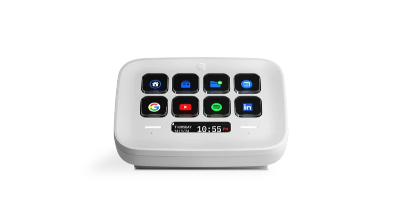

### Stream Deck

Stream Deck features 15 customizable LCD keys to control apps and platforms. Hit the store for app plugins, icons, tracks plus effects, and keep your setup fresh with interchangeable faceplates.

- 15 customizable LCD keys.

<!-- Image Source: https://www.elgato.com/us/en/s/media-room -->

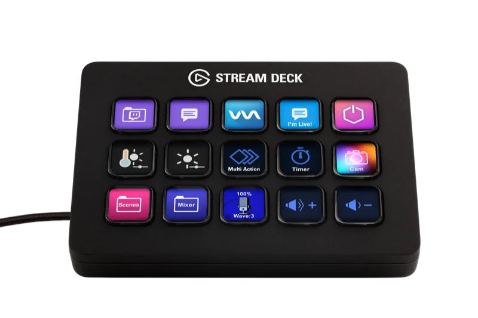

### Stream Deck Scissor Keys

Same Stream Deck power, now with a sharper snap. Smooth, fast, and precise, each key press enables you to control apps, platforms, and devices like never before.

- 15 customizable LCD keys.

<!-- Image Source: https://www.elgato.com/us/en/s/media-room -->

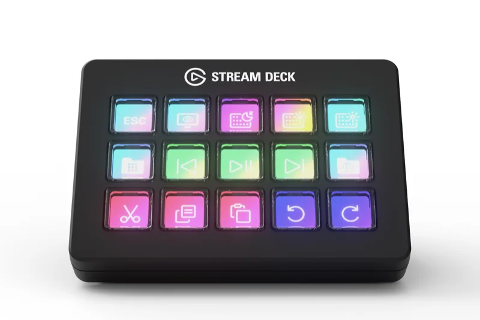

<a id="stream-deck-plus"></a>

### Stream Deck +

Iconic Stream Deck tech with customizable LCD keys, dials, and touch strip. Stream Deck + is your audio mixer, studio controller, production console – anything you want it to be.

- 8 customizable LCD keys.
- 4 dials with rotation and press, with touch strip.

<!-- Image Source: https://www.elgato.com/us/en/s/media-room -->

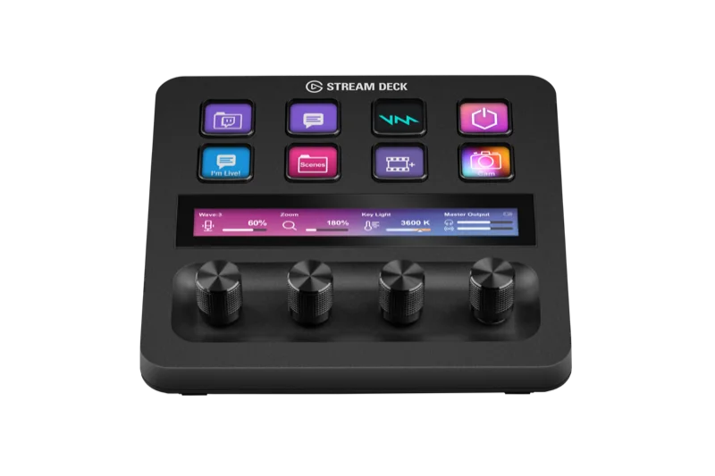

<a id="stream-deck-plus-xl"></a>

### Stream Deck + XL

With dozens of customizable controls and endless integrations, Stream Deck + XL puts entire productions and systems under your command—all from one intuitive interface.

- 36 customizable LCD keys.
- 6 dials with rotation and press, with touch strip.

<!-- Image Source: https://www.elgato.com/us/en/s/media-room -->

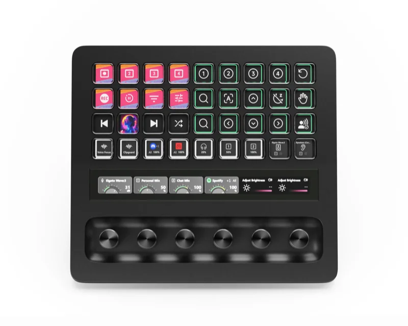

### Stream Deck XL

Boasting 32 customizable LCD keys poised to launch unlimited actions with a tap, Stream Deck XL takes production control to a whole new level.

- 32 customizable LCD keys.

<!-- Image Source: https://www.elgato.com/us/en/s/media-room -->

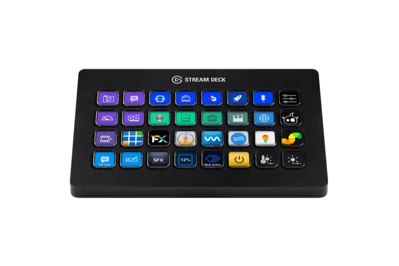

### Stream Deck Mini

With Stream Deck Mini, take full control of your content and focus on what matters most: your audience.

- 6 customizable LCD keys.

<!-- Image Source: https://www.elgato.com/us/en/s/media-room -->

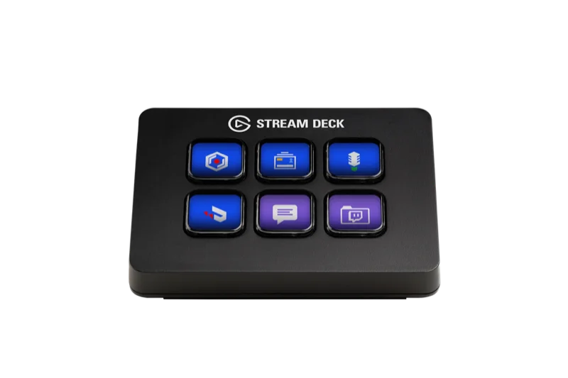

### Stream Deck Pedal

Sturdy, customizable and discreet, Stream Deck Pedal gives you instant hands-free control of your apps and tools.

- 3 customizable pedals.

<!-- Image Source: https://www.elgato.com/us/en/s/media-room -->

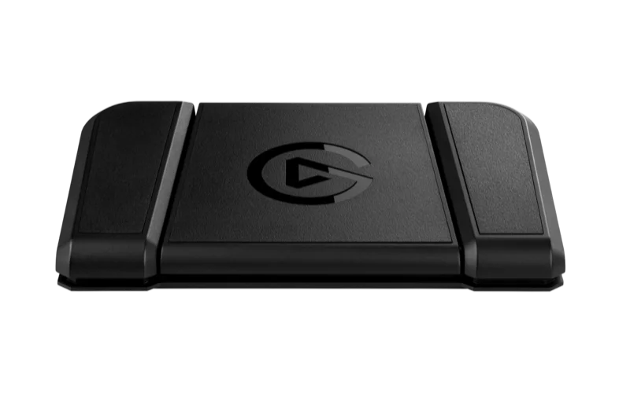

### Stream Deck Studio

Iconic Elgato hardware powered by custom Bitfocus software. Meet Stream Deck Studio, a hyper-customizable control surface for pro broadcast systems. Built to simplify complex workflows.

- 32 customizable LCD keys.
- 2 dials with rotation and press.

<!-- Image Source: https://www.elgato.com/us/en/s/media-room -->

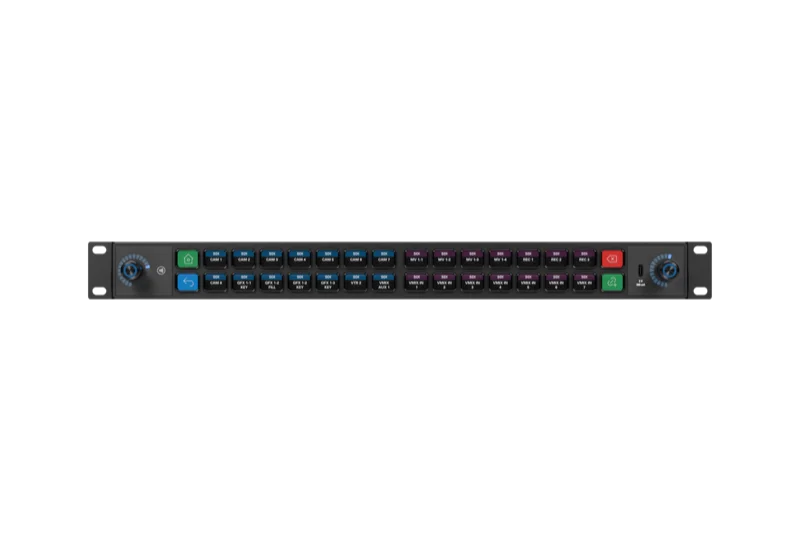

### Stream Deck Mobile

Stream Deck Mobile brings professional stream control, powerful integrations, and the iconic Stream Deck workflow to your iPhone or Android phone.

- Up to 64 customizable LCD keys.

<!-- Image Source: https://www.elgato.com/us/en/s/media-room -->

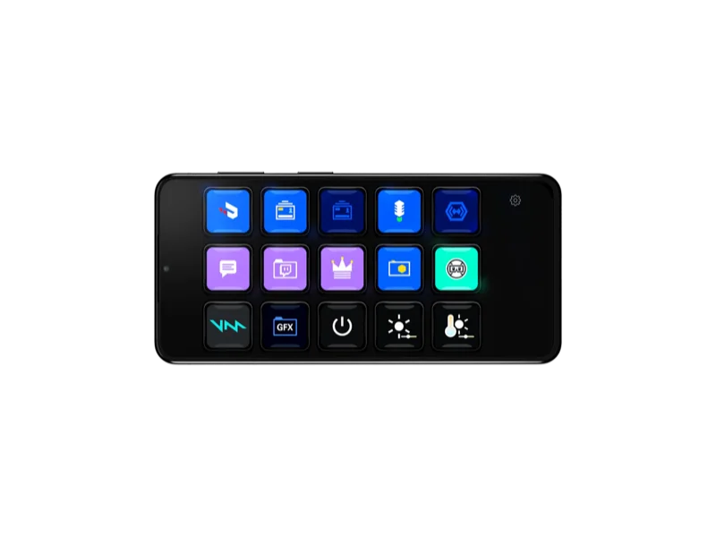

<a id="galleon-100-sd"></a>

### Corsair Galleon 100 SD

The first high-performance gaming keyboard with a built-in Stream Deck is here. Galleon 100 SD combines Corsair and Elgato engineering for deep control and insight at your fingertips.

- 2 dials with rotation and press.
- LCD screen
- 12 customizable LCD keys.

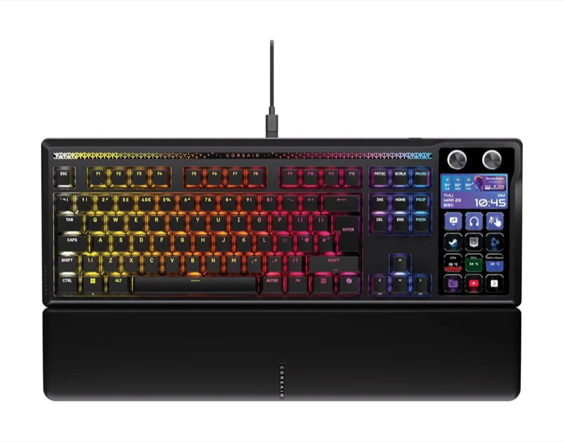

### Corsair G-Keys

- 6 customizable macro keys.

<!-- Image Source: https://assets.corsair.com/image/upload/c_pad,q_auto,h_1024,w_1024/products/Gaming-Keyboards/CH-9226065-NA/Gallery/K55_RGB_PRO_01.png?width=640&quality=85&auto=webp&format=pjpg -->

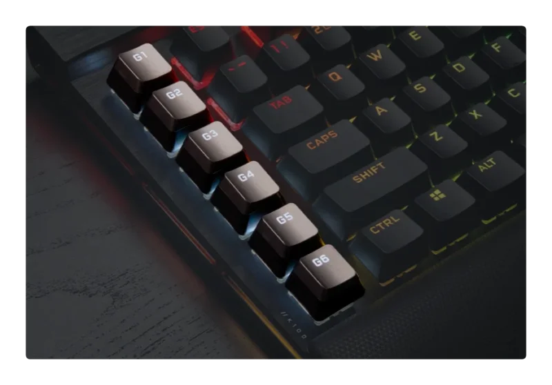

### Corsair Voyager

The Corsair Voyager combines cutting-edge gaming performance with the best of Corsair, powered by the latest AMD Ryzen™ processors and AMD Radeon™ graphics.

- Up to 10 customizable capacitive keys

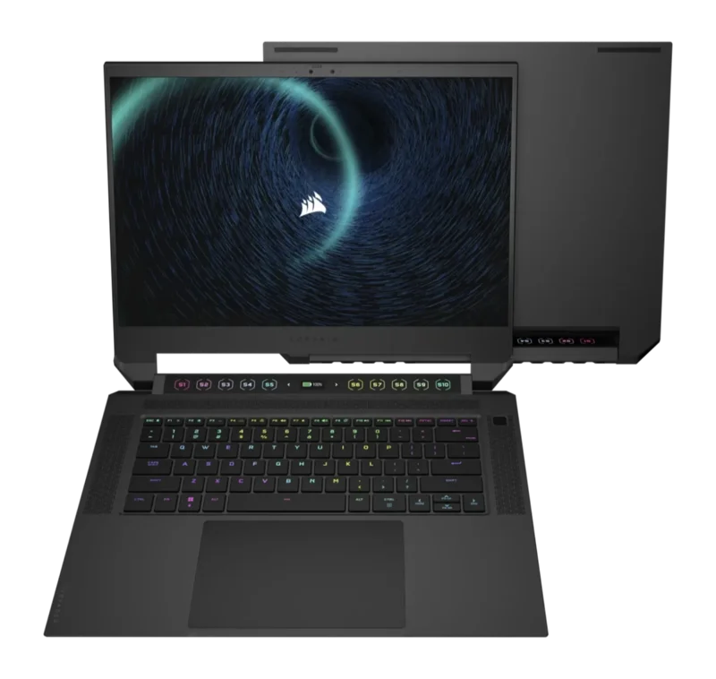

### SCUF Controller

Designed specifically for PC gaming, Envision has more inputs than your standard controller allowing you endless customization and the performance you need.

- 5 customizable macro buttons.

<!-- Image Source: https://corsair.mediavalet.com/browse/assets/1cc01af3-bf82-4a3d-b9d3-cd9856f7fbf3/full-screen?count=25&offset=0&sort=record.createdAt%20D&categoryId=572e458a-7e27-45b8-b42d-adb1fe3de90d -->

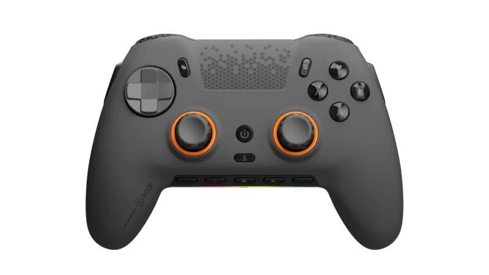
