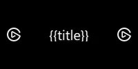

# Dials & Touch Strip

Dial actions are a combination of two parts of Stream Deck, the dial itself and a portion of the touch strip.

## What are dials?

The dial and touch strip portion that make up a dial action are collectively known as an "Encoder". Combined, they allow for your plugin to receive dial and touch events, as well as provide feedback on the touch strip in the form of layouts.


## Layouts

Layouts are the rendering engine used to display information on a Stream Deck + (Classic | XL) touch strip. Layouts on Stream Deck + (Classic | XL) are 200 × 100 px, and are composed of [layout items](../references/layouts.md) whose values can be updated at runtime to display dynamic information.

There are several [built-in layouts](#built-in-layouts) available to dial actions. Alternatively dial actions may use [custom layouts](#custom-layouts).

### Built-in Layouts

There are several built-in layouts available when rendering information on the Stream Deck + touch strip.

<Tabs>
<TabItem value="Icon ($X1)">


<!-- snippet: json/layouts/$x1.json -->

```jsonc title='JSON file for pre-defined layout "$X1"'
{
    "$schema": "https://schemas.elgato.com/streamdeck/plugins/layout.json",
    "id": "$X1",
    "items": [
        {
            "key": "title",
            "type": "text",
            "rect": [16, 10, 136, 24],
            "font": { "size": 16, "weight": 600 },
            "alignment": "left"
        },
        {
            "key": "icon",
            "type": "pixmap",
            "rect": [76, 40, 48, 48]
        }
    ]
}
```

</TabItem>
<TabItem value="Canvas ($A0)">


Note: The `canvas` is denoted in yellow, and the `full-canvas` in gray.

<!-- snippet: json/layouts/$a0.json -->

```jsonc title='JSON file for pre-defined layout "$A0"'
{
    "$schema": "https://schemas.elgato.com/streamdeck/plugins/layout.json",
    "id": "$A0",
    "items": [
        {
            "key": "full-canvas",
            "type": "pixmap",
            "rect": [0, 0, 200, 100]
        },
        {
            "key": "title",
            "type": "text",
            "rect": [16, 10, 136, 24],
            "zOrder": 1,
            "font": { "size": 16, "weight": 600 },
            "alignment": "left"
        },
        {
            "key": "canvas",
            "type": "pixmap",
            "rect": [16, 34, 136, 54],
            "zOrder": 1
        }
    ]
}
```

</TabItem>
<TabItem value="Value ($A1)">


<!-- snippet: json/layouts/$a1.json -->

```jsonc title='JSON file for pre-defined layout "$A1"'
{
    "$schema": "https://schemas.elgato.com/streamdeck/plugins/layout.json",
    "id": "$A1",
    "items": [
        {
            "key": "title",
            "type": "text",
            "rect": [16, 10, 136, 24],
            "font": { "size": 16, "weight": 600 },
            "alignment": "left"
        },
        {
            "key": "icon",
            "type": "pixmap",
            "rect": [16, 40, 48, 48]
        },
        {
            "key": "value",
            "type": "text",
            "rect": [76, 40, 108, 32],
            "font": { "size": 24, "weight": 600 },
            "alignment": "right"
        }
    ]
}
```

</TabItem>
<TabItem value="Indicator ($B1)">


<!-- snippet: json/layouts/$b1.json -->

```jsonc title='JSON file for pre-defined layout "$B1"'
{
    "$schema": "https://schemas.elgato.com/streamdeck/plugins/layout.json",
    "id": "$B1",
    "items": [
        {
            "key": "title",
            "type": "text",
            "rect": [16, 10, 136, 24],
            "font": { "size": 16, "weight": 600 },
            "alignment": "left"
        },
        {
            "key": "icon",
            "type": "pixmap",
            "rect": [16, 40, 48, 48]
        },
        {
            "key": "value",
            "type": "text",
            "rect": [76, 40, 108, 32],
            "font": { "size": 24, "weight": 600 },
            "alignment": "right"
        },
        {
            "key": "indicator",
            "type": "bar",
            "rect": [76, 74, 108, 12],
            "value": 0,
            "subtype": 4,
            "border_w": 0
        }
    ]
}
```

</TabItem>
<TabItem value="Gradient indicator ($B2)">


<!-- snippet: json/layouts/$b2.json -->

```jsonc title='JSON file for pre-defined layout "$B2"'
{
    "$schema": "https://schemas.elgato.com/streamdeck/plugins/layout.json",
    "id": "$B2",
    "items": [
        {
            "key": "title",
            "type": "text",
            "rect": [16, 10, 136, 24],
            "font": { "size": 16, "weight": 600 },
            "alignment": "left"
        },
        {
            "key": "icon",
            "type": "pixmap",
            "rect": [16, 40, 48, 48]
        },
        {
            "key": "value",
            "type": "text",
            "rect": [76, 40, 108, 32],
            "font": { "size": 24, "weight": 600 },
            "alignment": "right"
        },
        {
            "key": "indicator",
            "type": "gbar",
            "rect": [76, 74, 108, 20],
            "value": 0,
            "subtype": 4,
            "bar_h": 12,
            "border_w": 0,
            "bar_bg_c": "0:#ff0000,0.33:#a6d4ec,0.66:#f4b675,1:#00ff00"
        }
    ]
}
```

</TabItem>
<TabItem value="Double indicator ($C1)">


<!-- snippet: json/layouts/$c1.json -->

```jsonc title='JSON file for pre-defined layout "$C1"'
{
    "$schema": "https://schemas.elgato.com/streamdeck/plugins/layout.json",
    "id": "$C1",
    "items": [
        {
            "key": "title",
            "type": "text",
            "rect": [16, 10, 136, 24],
            "font": { "size": 16, "weight": 600 },
            "alignment": "left"
        },
        {
            "key": "icon1",
            "type": "pixmap",
            "rect": [16, 40, 24, 24]
        },
        {
            "key": "icon2",
            "type": "pixmap",
            "rect": [16, 68, 24, 24]
        },
        {
            "key": "indicator1",
            "type": "bar",
            "rect": [48, 46, 136, 12],
            "value": 0,
            "subtype": 4,
            "border_w": 0
        },
        {
            "key": "indicator2",
            "type": "bar",
            "rect": [48, 74, 136, 12],
            "value": 0,
            "subtype": 4,
            "border_w": 0
        }
    ]
}
```

</TabItem>
</Tabs>

### Custom Layouts

Custom layouts are represented as JSON files, located in the `*.sdPlugin` folder. Layout files are composed of [layout items](../references/layouts.md) that define the structure of the layout; the value of these items can then be controlled at runtime to display dynamic information. On Stream Deck + (Classic | XL), layouts are 200 × 100 px.

The following is an example of a custom layout that renders the title, with an image on either side:

<!-- snippet: json/layouts/custom-encoder.json -->

```jsonc title="Custom layout JSON file"
{
    "$schema": "https://schemas.elgato.com/streamdeck/plugins/layout.json",
    "id": "custom-layout",
    "controller": "Encoder",
    "items": [
        {
            "type": "pixmap",
            "key": "leading",
            "rect": [10, 40, 20, 20]
        },
        {
            "key": "title",
            "type": "text",
            "rect": [40, 40, 120, 20],
            "font": {
                "size": 20
            }
        },
        {
            "key": "trailing",
            "type": "pixmap",
            "rect": [170, 40, 20, 20]
        }
    ]
}
```



In summary, layout items within a layout:

- Must have a unique `key`.
- Must have their `type` and `rect` defined.
- Must not overlap with other items in the layout, see [`zOrder`](../references/layouts.md#bar-zorder).
- Must be within the bounds of the layout.

Layout items can also be assigned a pre-defined `key` that will enable users to control them—these are:

- `"title"` — as with [key actions](./keys.md#display-precedence), users can set a custom title for dial/touch strip actions, which will take precedence over the plugin provided title.
- `"icon"` — as with [key actions](./keys.md#display-precedence), users can set a custom icon for dial/touch strip actions, which will take precedence over the plugin provided icon.

> [!WARNING]
> Layouts will not render when:
>
> - A layout item is outside the allotted bounds of the layout.
> - Layout items overlap on the same `zOrder`.
>
> For assistance with debugging layouts, try using the CLI tool's [`validate`](https://docs.elgato.com/streamdeck/cli/commands/validate) command, or referring to the [Stream Deck app logs](./logging.md#stream-deck-logs).

### Setting Default Layouts

The default layout of an action is defined within the manifest by specifying the [`Actions[].Encoder.layout`](../references/manifest.md#encoder-layout) property. This value can be either the name of a built-in layout, or the file path to a custom layout.

<!-- snippet: json/manifest/built-in-layout.jsonc -->

```jsonc title="Default layout using a built-in layout" {8-11}
{
    "$schema": "https://schemas.elgato.com/streamdeck/plugins/manifest.json",
    "Actions": [
        {
            "Icon": "action-icon",
            "Name": "Action One",
            "Controllers": ["Encoder"],
            "Encoder": {
                "layout": "$B1"
            },
            "States": [
                {
                    "Image": "state-image"
                }
            ],
            "UUID": "come.elgato.test.one"
        }
    ],
    "Author": "Elgato",
    "Software": {
        "MinimumVersion": "6.6"
    }
    // ...
}
```

<!-- snippet: json/manifest/custom-layout.jsonc -->

```jsonc title="Default layout using a custom layout file" {8-11}
{
    "$schema": "https://schemas.elgato.com/streamdeck/plugins/manifest.json",
    "Actions": [
        {
            "Icon": "action-icon",
            "Name": "Action One",
            "Controllers": ["Encoder"],
            "Encoder": {
                "layout": "custom-layout.json"
            },
            "States": [
                {
                    "Image": "state-image"
                }
            ],
            "UUID": "come.elgato.test.one"
        }
    ],
    "Author": "Elgato",
    "Software": {
        "MinimumVersion": "6.6"
    }
    // ...
}
```

### Changing Layouts

The layout of a dial action instance can be changed at runtime using the [`setFeedbackLayout`](#setfeedbacklayout) function, for example:

<!-- snippet: node/guides/dials/set-feedback-layout.ts -->

```ts title="Action class updating its layout to a custom layout file" {11}
import { action, SingletonAction, WillAppearEvent } from "@elgato/streamdeck";

@action({ UUID: "com.elgato.test.one" })
export class IncrementCounter extends SingletonAction {
	/**
	 * Occurs when the action will appear.
	 */
	override async onWillAppear(ev: WillAppearEvent): Promise<void> {
		if (ev.action.isDial()) {
			// Specify built-in layout name (e.g. "$B1"), or path to the custom layout file.
			await ev.action.setFeedbackLayout("custom-layout.json");
		}
	}
}
```

### Updating Layout Items

Layout items can be updated at runtime using the [`setFeedback`](#setfeedback) function, with items referenced by their `key`. All properties, with the exception of their `rect` can be updated; in addition, the `value` of a layout item can be updated implicitly or explicitly.

The following example demonstrates updating the `value` of the `indicator` item implicitly:

<!-- snippet: node/guides/dials/set-feedback-implicitly.ts -->

```ts title="Updating $B1's indicator implicitly" {10}
import { action, DialUpEvent, SingletonAction } from "@elgato/streamdeck";

@action({ UUID: "com.elgato.layout-image-test.increment" })
export class IncrementCounter extends SingletonAction<CounterSettings> {
	/**
	 * Occurs when the user releases a dial.
	 */
	override async onDialUp(ev: DialUpEvent<CounterSettings>): Promise<void> {
		await ev.action.setFeedback({
			indicator: 50,
		});
	}
}

/**
 * Settings for {@link IncrementCounter}.
 */
type CounterSettings = {
	count?: number;
	incrementBy?: number;
};
```

The following example demonstrates updating the `value` of the `indicator` item explicitly:

<!-- snippet: node/guides/dials/set-feedback-explicitly.ts -->

```ts title="Updating $B1's indicator explicitly" {11}
import { action, DialUpEvent, SingletonAction } from "@elgato/streamdeck";

@action({ UUID: "com.elgato.layout-image-test.increment" })
export class IncrementCounter extends SingletonAction<CounterSettings> {
	/**
	 * Occurs when the user releases a dial.
	 */
	override async onDialUp(ev: DialUpEvent<CounterSettings>): Promise<void> {
		await ev.action.setFeedback({
			indicator: {
				value: 50,
				range: {
					min: 0,
					max: 100,
				},
			},
		});
	}
}

/**
 * Settings for {@link IncrementCounter}.
 */
type CounterSettings = {
	count?: number;
	incrementBy?: number;
};
```


## Trigger Descriptions

Trigger descriptions can help the user to understand what the encoder does in a particular dial action. This can be set in the manifest file using the [`Actions[].Encoder.TriggerDescriptions`](../references/manifest.md#triggerdescriptions) property.


<!-- snippet: json/manifest/trigger-description.jsonc -->

```jsonc title="Manifest JSON file, with an action referencing a trigger description" {9-15}
{
    "Actions": [
        {
            "Icon": "action-icon",
            "Name": "Trigger Description Example",
            "Controllers": ["Encoder"],
            "Encoder": {
                "layout": "$A1",
                "TriggerDescription": {
                    "Push": "Play / Pause",
                    "Rotate": "Adjust Volume",
                    "Touch": "Play / Pause",
                    "LongTouch": "Skip Track"
                }
            }
        }
    ]
    // ...
}
```

### Update Trigger Descriptions

You can programmatically update the trigger descriptions using the [`setTriggerDescription`](#settriggerdescription) function.

<!-- snippet: node/guides/dials/set-trigger-description.ts -->

```ts title="Action class updating its trigger description" {9-15}
import { action, DialUpEvent, SingletonAction } from "@elgato/streamdeck";

@action({ UUID: "com.elgato.trigger-description-example.increment" })
export class IncrementCounter extends SingletonAction<CounterSettings> {
	/**
	 * Occurs when the user releases a dial.
	 */
	override async onDialUp(ev: DialUpEvent<CounterSettings>): Promise<void> {
		await ev.action.setTriggerDescription({
			push: "Increment counter",
			rotate: "Adjust increment",
			touch: "Increment counter",
			longTouch: "Reset counter",
		});
	}
}

/**
 * Settings for {@link IncrementCounter}.
 */
type CounterSettings = {
	count?: number;
	incrementBy?: number;
};
```

## Events

Dial actions receive the following events, available as overridable methods on the `SingletonAction` class.

<!-- generated: dials-events -->

### onDialDown

Occurs when the user presses a dial (Stream Deck +). See also `SingletonAction.onDialUp`.

NB: For other action types see `SingletonAction.onKeyDown`.

```ts
function onDialDown?(ev: DialDownEvent): void | Promise<void>
```

**Parameters**

| Name | Type | Description |
| --- | --- | --- |
| `ev` | `DialDownEvent` | Information about the event, including the source action and contextual payload information. |

### onDialRotate

Occurs when the user rotates a dial (Stream Deck +).

```ts
function onDialRotate?(ev: DialRotateEvent): void | Promise<void>
```

**Parameters**

| Name | Type | Description |
| --- | --- | --- |
| `ev` | `DialRotateEvent` | Information about the event, including the source action and contextual payload information. |

### onDialUp

Occurs when the user releases a pressed dial (Stream Deck +). See also `SingletonAction.onDialDown`.

NB: For other action types see `SingletonAction.onKeyUp`.

```ts
function onDialUp?(ev: DialUpEvent): void | Promise<void>
```

**Parameters**

| Name | Type | Description |
| --- | --- | --- |
| `ev` | `DialUpEvent` | Information about the event, including the source action and contextual payload information. |

### onDidReceiveResources

Occurs when the resources are updated within the property inspector.

```ts
function onDidReceiveResources?(ev: DidReceiveResourcesEvent): void | Promise<void>
```

**Parameters**

| Name | Type | Description |
| --- | --- | --- |
| `ev` | `DidReceiveResourcesEvent` | Function to be invoked when the event occurs. |

### onDidReceiveSettings

Occurs when the settings are updated within the property inspector.

When `streamDeck.settings.useLegacySettingsBehavior` is set to `true`, this also fires after
calling `getSettings()`.

```ts
function onDidReceiveSettings?(ev: DidReceiveSettingsEvent): void | Promise<void>
```

**Parameters**

| Name | Type | Description |
| --- | --- | --- |
| `ev` | `DidReceiveSettingsEvent` | Information about the event, including the source action and contextual payload information. |

### onPropertyInspectorDidAppear

Occurs when the property inspector associated with the action becomes visible, i.e. the user selected an action in the Stream Deck application. See also `streamDeck.ui.onDidAppear`.

```ts
function onPropertyInspectorDidAppear?(ev: PropertyInspectorDidAppearEvent): void | Promise<void>
```

**Parameters**

| Name | Type | Description |
| --- | --- | --- |
| `ev` | `PropertyInspectorDidAppearEvent` | Information about the event, including the source action. |

### onPropertyInspectorDidDisappear

Occurs when the property inspector associated with the action becomes invisible, i.e. the user unselected the action in the Stream Deck application. See also `streamDeck.ui.onDidDisappear`.

```ts
function onPropertyInspectorDidDisappear?(ev: PropertyInspectorDidDisappearEvent): void | Promise<void>
```

**Parameters**

| Name | Type | Description |
| --- | --- | --- |
| `ev` | `PropertyInspectorDidDisappearEvent` | Information about the event, including the source action. |

### onSendToPlugin

Occurs when a message was sent to the plugin _from_ the property inspector. The plugin can also send messages _to_ the property inspector using `streamDeck.ui.sendToPropertyInspector`.

```ts
function onSendToPlugin?(ev: SendToPluginEvent): void | Promise<void>
```

**Parameters**

| Name | Type | Description |
| --- | --- | --- |
| `ev` | `SendToPluginEvent` | Information about the event, including the source action and contextual payload information. |

### onTitleParametersDidChange

Occurs when the user updates an action's title settings in the Stream Deck application.

```ts
function onTitleParametersDidChange?(ev: TitleParametersDidChangeEvent): void | Promise<void>
```

**Parameters**

| Name | Type | Description |
| --- | --- | --- |
| `ev` | `TitleParametersDidChangeEvent` | Information about the event, including the source action and contextual payload information. |

### onTouchTap

Occurs when the user taps the touchscreen (Stream Deck +).

```ts
function onTouchTap?(ev: TouchTapEvent): void | Promise<void>
```

**Parameters**

| Name | Type | Description |
| --- | --- | --- |
| `ev` | `TouchTapEvent` | Information about the event, including the source action and contextual payload information. |

### onWillAppear

Occurs when an action appears on the Stream Deck due to the user navigating to another page, profile, folder, etc. This also occurs during startup if the action is on the "front
page". An action refers to _all_ types of actions, e.g. keys, dials,

```ts
function onWillAppear?(ev: WillAppearEvent): void | Promise<void>
```

**Parameters**

| Name | Type | Description |
| --- | --- | --- |
| `ev` | `WillAppearEvent` | Information about the event, including the source action and contextual payload information. |

### onWillDisappear

Occurs when an action disappears from the Stream Deck due to the user navigating to another page, profile, folder, etc. An action refers to _all_ types of actions, e.g. keys,
dials, touchscreens, pedals, etc.

```ts
function onWillDisappear?(ev: WillDisappearEvent): void | Promise<void>
```

**Parameters**

| Name | Type | Description |
| --- | --- | --- |
| `ev` | `WillDisappearEvent` | Information about the event, including the source action and contextual payload information. |

<!-- /generated -->

## Commands

The following commands are available to dial actions.

> [!WARNING]
> Some events, such as [`onWillAppear`](./actions.md#onwillappear), are applicable to all action types. To invoke commands only available to dial actions within these events, you must first assert the action is a dial by calling [`ev.action.isDial()`](./actions.md#isdial).

<!-- generated: dials-commands -->

### getResources

Gets the resources (files) associated with this action; these resources are embedded into the action when it is
exported, either individually, or as part of a profile.

Available from Stream Deck 7.1.

```ts
function getResources(): Promise<Resources>
```

### getSettings

Gets the settings associated this action instance.

```ts
function getSettings(): Promise<TSettings>
```

### setFeedback

Sets the feedback for the current layout associated with this action instance, allowing for the visual items to be updated. Layouts are a powerful way to provide dynamic information
to users, and can be assigned in the manifest, or dynamically via `DialAction.setFeedbackLayout`.

The `feedback` payload defines which items within the layout will be updated, and are identified by their property name (defined as the `key` in the layout's definition).
The values can either by a complete new definition, a `string` for layout item types of `text` and `pixmap`, or a `number` for layout item types of `bar` and `gbar`.

```ts
function setFeedback(feedback: FeedbackPayload): Promise<void>
```

**Parameters**

| Name | Type | Description |
| --- | --- | --- |
| `feedback` | `FeedbackPayload` | Object containing information about the layout items to be updated. |

### setFeedbackLayout

Sets the layout associated with this action instance. The layout must be either a built-in layout identifier, or path to a local layout JSON file within the plugin's folder.
Use in conjunction with `DialAction.setFeedback` to update the layout's current items' settings.

```ts
function setFeedbackLayout(layout: string): Promise<void>
```

**Parameters**

| Name | Type | Description |
| --- | --- | --- |
| `layout` | `string` | Name of a pre-defined layout, or relative path to a custom one. |

### setImage

Sets the `image` to be display for this action instance within Stream Deck app.

NB: The image can only be set by the plugin when the the user has not specified a custom image.

```ts
function setImage(image?: string): Promise<void>
```

**Parameters**

| Name | Type | Description |
| --- | --- | --- |
| `image` | `string` (optional) | Image to display; this can be either a path to a local file within the plugin's folder, a base64 encoded `string` with the mime type declared (e.g. PNG, JPEG, etc.), or an SVG `string`. When `undefined`, the image from the manifest will be used. |

### setResources

Sets the resources (files) associated with this action; these resources are embedded into the action when it is
exported, either individually, or as part of a profile.

Available from Stream Deck 7.1.

```ts
function setResources(resources: Resources): Promise<void>
```

**Parameters**

| Name | Type | Description |
| --- | --- | --- |
| `resources` | `Resources` | The resources as a map of file paths. |

### setSettings

Sets the settings associated with this action instance.

```ts
function setSettings(value: TSettings): Promise<void>
```

**Parameters**

| Name | Type | Description |
| --- | --- | --- |
| `value` | `TSettings` | Settings to persist. |

### setTitle

Sets the `title` displayed for this action instance.

NB: The title can only be set by the plugin when the the user has not specified a custom title.

```ts
function setTitle(title: string): Promise<void>
```

**Parameters**

| Name | Type | Description |
| --- | --- | --- |
| `title` | `string` | Title to display. |

### setTriggerDescription

Sets the trigger (interaction) `descriptions` associated with this action instance. Descriptions are shown within the Stream Deck application, and informs the user what
will happen when they interact with the action, e.g. rotate, touch, etc. When `descriptions` is `undefined`, the descriptions will be reset to the values provided as part
of the manifest.

NB: Applies to encoders (dials / touchscreens) found on Stream Deck + devices.

```ts
function setTriggerDescription(descriptions?: TriggerDescriptionOptions): Promise<void>
```

**Parameters**

| Name | Type | Description |
| --- | --- | --- |
| `descriptions` | `TriggerDescriptionOptions` (optional) | Descriptions that detail the action's interaction. |

### showAlert

Shows a temporary alert (i.e. warning) indicator on the touch strip associated with the action.

```ts
function showAlert(): Promise<void>
```

<!-- /generated -->
