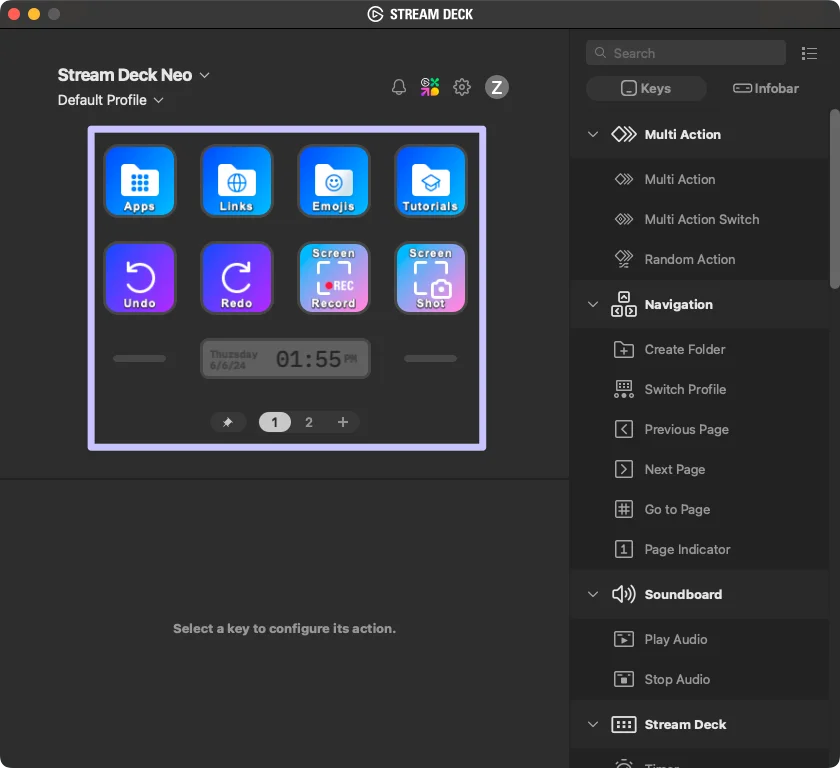
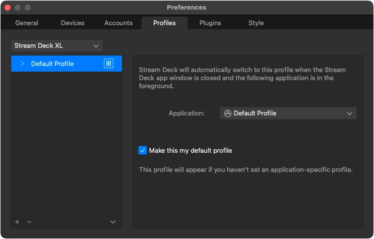

# Profiles

Stream Deck Profiles are shareable layouts, specific to a Stream Deck device, that can include pre-defined actions, icons, and settings. Bundling Stream Deck profiles into your plugin can be useful in scenarios such as streamlining the users set up experience, or providing additional functionality utilizing the full Stream Deck canvas.



## Creating a Profile

Profiles are configured by dragging your plugin's actions from the Steam Deck app's action list onto the canvas. Once your profile includes the actions you need, navigate to the profiles tab in the Stream Deck preferences, right-click the profile you wish to export, and select "Export". This will save you profile as a `.streamDeckProfile` file.



## Bundling

Once you have your `.streamDeckProfile` file, you can utilize it in your plugin by adding it to the `*.sdPlugin` directory, and registering it in the `Profiles` array in the plugin's manifest.

<!-- snippet: json/manifest.json -->

```json title='Example of "Profiles" within the manifest JSON file' {49-57}
{
    "$schema": "https://schemas.elgato.com/streamdeck/plugins/manifest.json",
    "UUID": "com.elgato.hello-world",
    "Name": "Hello World",
    "Version": "0.1.0.0",
    "Author": "Elgato",
    "Actions": [
        {
            "Name": "Counter",
            "UUID": "com.elgato.hello-world.increment",
            "Icon": "static/imgs/actions/counter/icon",
            "Tooltip": "Displays a count, which increments by one on press.",
            "Controllers": ["Keypad"],
            "States": [
                {
                    "Image": "static/imgs/actions/counter/key",
                    "TitleAlignment": "middle"
                }
            ]
        }
    ],
    "Category": "Hello World",
    "CategoryIcon": "static/imgs/plugin/category-icon",
    "CodePath": "bin/plugin.js",
    "Description": ".",
    "Icon": "static/imgs/plugin/marketplace",
    "SDKVersion": 2,
    "Software": {
        "MinimumVersion": "6.6"
    },
    "OS": [
        {
            "Platform": "mac",
            "MinimumVersion": "10.15"
        },
        {
            "Platform": "windows",
            "MinimumVersion": "10"
        }
    ],
    "Nodejs": {
        "Version": "20",
        "Debug": "enabled"
    },
    "ApplicationsToMonitor": {
        "mac": ["com.elgato.WaveLink"],
        "windows": ["Elgato Wave Link.exe"]
    },
    "Profiles": [
        {
            "Name": "My Cool Profile",
            "DeviceType": 0,
            "Readonly": false,
            "DontAutoSwitchWhenInstalled": false,
            "AutoInstall": true
        }
    ]
}
```

<Warning>
  **Exclude file extension**

  The `Name` in the manifest should be the path to the `.streamDeckProfile` file, relative to the manifest, **without** the extension.
</Warning>

<Tip>
  **Automatic installation**

  By default, users are prompted to install bundled Stream Deck profiles when the plugin is first installed. To disable this, you can setting `AutoInstall` to `false` in the manifest. The user will instead then be prompted to install the bundled profile the next time your plugin attempts to switch to it.
</Tip>

## Switching to a Profile

Now that you've created a profile for your target device, your plugin can switch to it using its name as the identifier.

<!-- snippet: node/guides/profiles/switch-to-profile.ts -->

```ts title="Switch profile on key down" {9}
import streamDeck, { action, KeyDownEvent, SingletonAction } from "@elgato/streamdeck";

@action({ UUID: "com.elgato.example.action" })
export class IncrementCounter extends SingletonAction {
	/**
	 * Occurs when the user presses the key action.
	 */
	override onKeyDown(ev: KeyDownEvent<CounterSettings>): void | Promise<void> {
		streamDeck.profiles.switchToProfile(ev.action.device.id, "My Cool Profile");
	}
}

type CounterSettings = {
	count: number;
};
```

<Warning>
  **User profiles**

  Plugins do not have access to user-defined profiles, and therefore cannot switch to them. Plugins can only switch to profiles distributed with the plugin.
</Warning>
