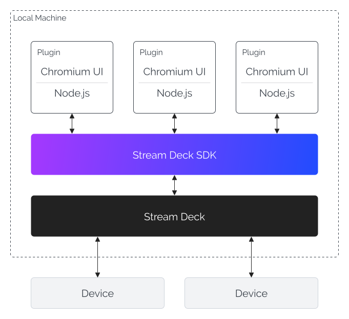
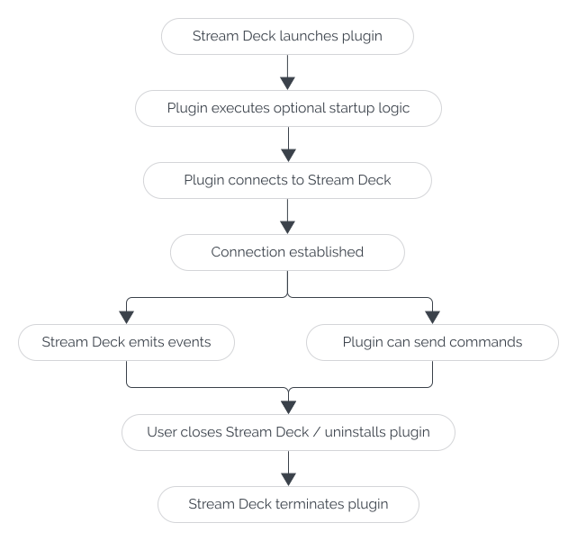

# Plugin Environment

In this article you'll learn more about how Stream Deck plugins built with the Stream Deck SDK are executed, and the different runtime environments.

## Host Environment

The architecture of a Stream Deck plugin is closely comparable to a web app, comprising of a frontend and a backend. Unlike a web app, a Stream Deck plugin is hosted entirely on the user's local machine, with all hardware communication managed by the Stream Deck app.

The host environment is summarized in the following diagram:



<Warning>
  **Secrets**

  Stream Deck plugins run locally on the user's machine and it is not recommended to include secrets, for example private API keys, when packaging and distributing your plugin.
</Warning>

## JavaScript Runtimes

Similar to a web app, the layers of a plugin use separate JavaScript runtimes.

| Layer                                                                         | Runtime                   | Responsibilities                                                                                                         |
| ----------------------------------------------------------------------------- | ------------------------- | ------------------------------------------------------------------------------------------------------------------------ |
| Application-layer (backend)                                                   | Node.js                   | The main logic that drives a plugin, responsible for handling events received from Stream Deck, for example a key press. |
| Presentation-layer (frontend), aka a "[property inspector](../guides/ui.md)" | Chromium, with DOM access | Views, in the form of HTML, rendered in the Stream Deck app, allowing a user to configure an action.                     |

### Runtime Versions

The latest JavaScript runtime versions are:

| Stream Deck | Node.js (application) | Chromium (UI) |
| --- | --- | --- |
| 7.3 | 20.20.0, 24.13.1 | 130.0.0.0 |
| 7.2 | 20.20.0, 24.13.1 | 130.0.0.0 |
| 7.1 | 20.20.0, 24.13.1 | 130.0.0.0 |

<details>
<summary>Full list of JavaScript runtime versions.</summary>

| Stream Deck | Node.js (application) | Chromium (UI) |
| --- | --- | --- |
| 7.3 | 20.20.0, 24.13.1 | 130.0.0.0 |
| 7.2 | 20.20.0, 24.13.1 | 130.0.0.0 |
| 7.1 | 20.20.0, 24.13.1 | 130.0.0.0 |
| 7.0 | 20.19.0 | 122.0.6261.171 |
| 6.9 | 20.19.0 | 122.0.6261.171 |
| 6.8 | 20.18.0 | 118.0.5993.220 |
| 6.7 | 20.15.0 | 118.0.5993.220 |
| 6.6 | 20.8.1 | 112.0.5615.213 |
| 6.5 | 20.8.1 | 108.0.5359.220 |
| 6.4 | 20.5.1 | 102.0.5005.177 |

</details>

<Tip>
  From Stream Deck 7.1, Node.js versions are automatically updated to the latest versions supported by Stream Deck.
</Tip>

## Manifest

The manifest defines the metadata of a Stream Deck plugin, in the form of a JSON file located at `./*.sdPlugin/manifest.json`, that includes:

- General information about the plugin, for example the name, author, description, etc.
- Actions, and their metadata, available to the user.
- Version compatibility with Stream Deck, Node.js, and operating systems.

<!-- snippet: json/manifest.json -->

```json title="Example manifest JSON file"
{
    "$schema": "https://schemas.elgato.com/streamdeck/plugins/manifest.json",
    "UUID": "com.elgato.hello-world",
    "Name": "Hello World",
    "Version": "0.1.0.0",
    "Author": "Elgato",
    "Actions": [
        {
            "Name": "Counter",
            "UUID": "com.elgato.hello-world.increment",
            "Icon": "static/imgs/actions/counter/icon",
            "Tooltip": "Displays a count, which increments by one on press.",
            "Controllers": ["Keypad"],
            "States": [
                {
                    "Image": "static/imgs/actions/counter/key",
                    "TitleAlignment": "middle"
                }
            ]
        }
    ],
    "Category": "Hello World",
    "CategoryIcon": "static/imgs/plugin/category-icon",
    "CodePath": "bin/plugin.js",
    "Description": ".",
    "Icon": "static/imgs/plugin/marketplace",
    "SDKVersion": 2,
    "Software": {
        "MinimumVersion": "6.6"
    },
    "OS": [
        {
            "Platform": "mac",
            "MinimumVersion": "10.15"
        },
        {
            "Platform": "windows",
            "MinimumVersion": "10"
        }
    ],
    "Nodejs": {
        "Version": "20",
        "Debug": "enabled"
    },
    "ApplicationsToMonitor": {
        "mac": ["com.elgato.WaveLink"],
        "windows": ["Elgato Wave Link.exe"]
    },
    "Profiles": [
        {
            "Name": "My Cool Profile",
            "DeviceType": 0,
            "Readonly": false,
            "DontAutoSwitchWhenInstalled": false,
            "AutoInstall": true
        }
    ]
}
```

For more information about the manifest, please refer to the [manifest API reference](../references/manifest.md).

## Plugin Lifecycle

Stream Deck is responsible for managing your plugin's lifecycle, and provides automatic failure recovery in the event an unexpected error occurs. An overview of the plugin lifecycle is as follows:


