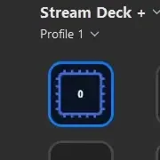
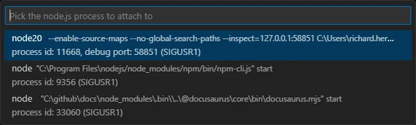

# Your First Changes

In this article you'll make changes to your newly generated Stream Deck plugin, and apply those changes in Stream Deck.

## Changing "Counter"

The logic that controls the "Counter" action, in the newly generated Stream Deck plugin, is located within the `IncrementCounter` class, which will look like this:

<!-- snippet: node/getting-started/making-changes/counter.ts -->
```ts title="src/actions/increment-counter.ts"
import { action, KeyDownEvent, SingletonAction, WillAppearEvent } from "@elgato/streamdeck";

@action({ UUID: "com.elgato.hello-world.increment" })
export class IncrementCounter extends SingletonAction<CounterSettings> {
	/**
	 * Occurs when the action will appear.
	 */
	override onWillAppear(ev: WillAppearEvent<CounterSettings>): void | Promise<void> {
		return ev.action.setTitle(`${ev.payload.settings.count ?? 0}`);
	}

	/**
	 * Occurs when the action's key is pressed down.
	 */
	override async onKeyDown(ev: KeyDownEvent<CounterSettings>): Promise<void> {
		// Determine the current count from the settings.
		let count = ev.payload.settings.count ?? 0;
		count++;

		// Update the current count in the action's settings, and change the title.
		await ev.action.setSettings({ count });
		await ev.action.setTitle(`${count}`);
	}
}

type CounterSettings = {
	count: number;
};
```

The `IncrementCounter` class implements two virtual methods, these are:

- `onWillAppear`
  - Occurs when the action appears on the canvas of Stream Deck.
  - In this example, displays the current count.
- `onKeyDown`
  - Occurs when the user presses the key down on Stream Deck
  - In this example, increments the count and shows the new count.

> [!TIP]
> Actions extend the `SingletonAction` class which provides virtual methods for intercepting events, for example:
>
> - `onWillDisappear`
> - `onKeyDown`
> - `onDialRotate`

> [!NOTE]
> **Scenario: Change request**
>
> "The counter action currently increments the count by 1 and then displays the new count. Instead, we want the counter to be a binary counter, which doubles the count each time the key is pressed."

Within the `IncrementCounter` class, the `onKeyDown` method can be updated so that the count is doubled on each press; the method could be updated to look something like this:

<!-- snippet: node/getting-started/making-changes/binary-counter.ts -->
```ts title="Key down event changes" {18-22}
import { action, KeyDownEvent, SingletonAction, WillAppearEvent } from "@elgato/streamdeck";

@action({ UUID: "com.elgato.hello-world.increment" })
export class IncrementCounter extends SingletonAction<CounterSettings> {
	/**
	 * Occurs when the action will appear.
	 */
	override onWillAppear(ev: WillAppearEvent<CounterSettings>): void | Promise<void> {
		return ev.action.setTitle(`${ev.payload.settings.count ?? 0}`);
	}

	/**
	 * Occurs when the action's key is pressed down.
	 */
	override async onKeyDown(ev: KeyDownEvent<CounterSettings>): Promise<void> {
		// Determine the current count from the settings, and times it by two.
		let count = ev.payload.settings.count ?? 0;
		if (count === 0) {
			count = 1;
		} else {
			count = count * 2;
		}

		// Update the current count in the action's settings, and change the title.
		await ev.action.setSettings({ count });
		await ev.action.setTitle(`${count}`);
	}
}

type CounterSettings = {
	count: number;
};
```

With these changes saved, build the plugin with the following command in a terminal:

<Tabs>
<TabItem value="npm" label="npm" default>

```bash
npm run build
```

</TabItem>
<TabItem value="yarn" label="yarn">

```bash
yarn build
```

</TabItem>
<TabItem value="pnpm" label="pnpm">

```bash
pnpm build
```

</TabItem>
</Tabs>

And then restart the plugin in Stream Deck with the following command in a terminal:

```text
streamdeck restart <plugin_uuid>
```

For example:

```bash
streamdeck restart com.elgato.hello-world
```

> [!TIP]
> **Plugin UUID**
>
> Your plugin's unique identifier is a reverse-DNS string generated during the `streamdeck create` command that represents your organization and product, for example `com.elgato.wavelink`.

Pressing the Stream Deck key now should double the count, like so:


## Hot-reload

In the previous chapter, the changes to the `IncrementCounter` were applied using two commands:

1. The `build` script.
1. `streamdeck restart <plugin_uuid>`

An alternative approach to applying changes in real-time is hot-reloading, or live-reloading. Plugins generated from `streamdeck create` come with hot-reload as standard; to begin watching for changes to files, run the following command in a terminal:

<Tabs>
<TabItem value="npm" label="npm" default>

```bash
npm run watch
```

</TabItem>
<TabItem value="yarn" label="yarn" default>

```bash
yarn watch
```

</TabItem>
<TabItem value="pnpm" label="pnpm" default>

```bash
pnpm watch
```

</TabItem>
</Tabs>

> [!NOTE]
> **Scenario: Change request**
>
> "The new a binary counter changes look great, but we've had a new request to reset the count to zero after it reaches 256."

With hot-reload running, let's apply changes for the new change request.

<!-- snippet: node/getting-started/making-changes/binary-counter-capped.ts -->
```ts title="More key down even changes" {18-24}
import { action, KeyDownEvent, SingletonAction, WillAppearEvent } from "@elgato/streamdeck";

@action({ UUID: "com.elgato.hello-world.increment" })
export class IncrementCounter extends SingletonAction<CounterSettings> {
	/**
	 * Occurs when the action will appear.
	 */
	override onWillAppear(ev: WillAppearEvent<CounterSettings>): void | Promise<void> {
		return ev.action.setTitle(`${ev.payload.settings.count ?? 0}`);
	}

	/**
	 * Occurs when the action's key is pressed down.
	 */
	override async onKeyDown(ev: KeyDownEvent<CounterSettings>): Promise<void> {
		// Determine the current count from the settings.
		let count = ev.payload.settings.count ?? 0;
		if (count === 0) {
			count = 1;
		} else if (count < 256) {
			count = count * 2;
		} else {
			count = 0;
		}

		// Update the current count in the action's settings, and change the title.
		await ev.action.setSettings({ count });
		await ev.action.setTitle(`${count}`);
	}
}

type CounterSettings = {
	count: number;
};
```

Upon saving the file, the change will trigger a re-build of the plugin, and will automatically restart the plugin in Stream Deck. The changes can then be tested:



## Debugging

Stream Deck plugins leverage Node.js' built-in inspector flag for debugging, allowing you to use popular external debugging tools, such as VS Code, to step-through your plugin's execution paths whilst testing.

Attaching to your Stream Deck plugin in VS Code can be achieved with the following steps:

1. In VS Code, open the "Quick Open" panel (`Ctrl+P` / `Cmd+P`)
2. Enter `> Debug: Attach to Node Process`, and press `Return`.
3. Select the `node20` process.



> [!TIP]
> By default, Stream Deck will automatically assign an available port to the [Node.js inspect flag](https://nodejs.org/docs/latest-v20.x/api/cli.html#--inspecthostport) to avoid conflicts. This behavior can be overridden in the manifest's `Nodejs.Debug` property.
