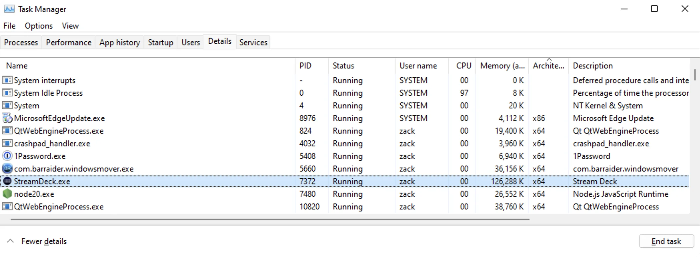

# App Monitoring

The Stream Deck SDK can notify your plugin when an application starts (launches) or stops (terminates), allowing it to monitor pre-registered apps. This can be particularly useful if your plugin relies or interacts with a local application, for example via IPC.

## Registering Apps

To monitor an application, the name of the application must be registered in the manifest JSON file using the `ApplicationsToMonitor` property.

<!-- snippet: json/manifest.json -->
```json title='Example of "ApplicationsToMonitor" within the manifest JSON file' {45-48}
{
    "$schema": "https://schemas.elgato.com/streamdeck/plugins/manifest.json",
    "UUID": "com.elgato.hello-world",
    "Name": "Hello World",
    "Version": "0.1.0.0",
    "Author": "Elgato",
    "Actions": [
        {
            "Name": "Counter",
            "UUID": "com.elgato.hello-world.increment",
            "Icon": "static/imgs/actions/counter/icon",
            "Tooltip": "Displays a count, which increments by one on press.",
            "Controllers": ["Keypad"],
            "States": [
                {
                    "Image": "static/imgs/actions/counter/key",
                    "TitleAlignment": "middle"
                }
            ]
        }
    ],
    "Category": "Hello World",
    "CategoryIcon": "static/imgs/plugin/category-icon",
    "CodePath": "bin/plugin.js",
    "Description": ".",
    "Icon": "static/imgs/plugin/marketplace",
    "SDKVersion": 2,
    "Software": {
        "MinimumVersion": "6.6"
    },
    "OS": [
        {
            "Platform": "mac",
            "MinimumVersion": "10.15"
        },
        {
            "Platform": "windows",
            "MinimumVersion": "10"
        }
    ],
    "Nodejs": {
        "Version": "20",
        "Debug": "enabled"
    },
    "ApplicationsToMonitor": {
        "mac": ["com.elgato.WaveLink"],
        "windows": ["Elgato Wave Link.exe"]
    },
    "Profiles": [
        {
            "Name": "My Cool Profile",
            "DeviceType": 0,
            "Readonly": false,
            "DontAutoSwitchWhenInstalled": false,
            "AutoInstall": true
        }
    ]
}
```

Finding the name / identifier of the of application depends on the operating system.

<Tabs>
<TabItem value="Windows" label="Windows" default>

For Windows apps, Stream Deck uses the app's executable name. This information is available in the details tab of
Windows Task manager. You can also navigate to the file directly in Windows explorer, or right-click on the apps
shortcut and select properties to find the target `exe` file.


</TabItem>
<TabItem value="macOS" label="macOS">

On macOS, Stream Deck uses the `CFBundleIdentifier` found in the apps `Info.plist` file. It is also possible to find this using osascript in your terminal.

```bash
osascript -e 'id of app "Application Name"'
```

</TabItem>
</Tabs>

## Apps Launching

To listen for a registered application launching, your plugin can subscribe to the `onApplicationDidLaunch` event.

<!-- snippet: node/guides/app-monitoring/application-did-launch.ts -->
```ts title="Application launch event callback" {3}
import streamDeck, { ApplicationDidLaunchEvent } from "@elgato/streamdeck";

streamDeck.system.onApplicationDidLaunch((ev: ApplicationDidLaunchEvent) => {
	// Handle a registered application launching
	streamDeck.logger.info(ev.application); // e.g. "Elgato Wave Link.exe"
});
```

## Apps Terminating

To listen for a registered application terminating, your plugin can subscribe to the `onApplicationDidTerminate` event.

<!-- snippet: node/guides/app-monitoring/application-did-terminate.ts -->
```ts title="Application terminate event callback" {3}
import streamDeck, { ApplicationDidTerminateEvent } from "@elgato/streamdeck";

streamDeck.system.onApplicationDidTerminate((ev: ApplicationDidTerminateEvent) => {
	// Handle a registered application terminating.
	streamDeck.logger.info(ev.application); // e.g. "Elgato Wave Link.exe"
});
```
