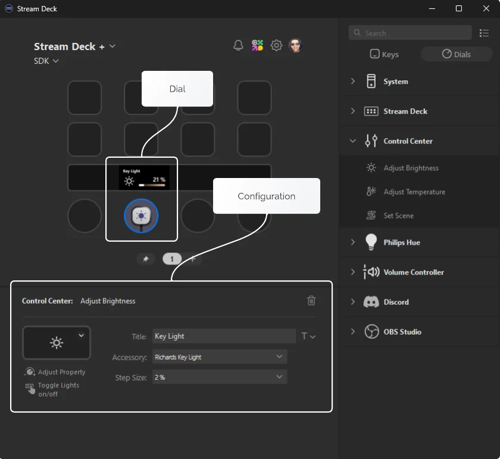
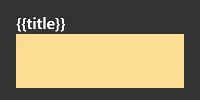
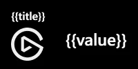
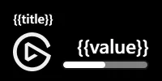
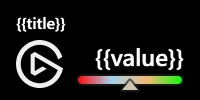
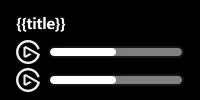
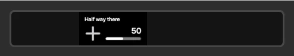
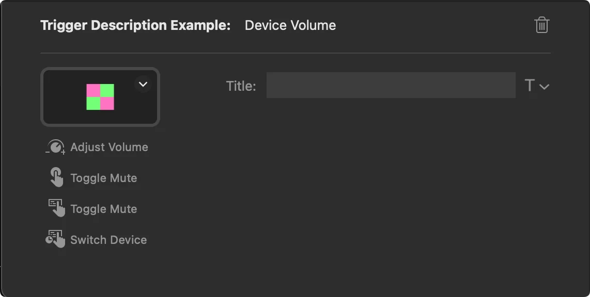

# Dials & Touch Strip

Dial actions are a combination of two parts of Stream Deck, the dial itself and a portion of the touch strip.

## What is an Encoder?

The dial and portion of the touch strip that make up a dial action are collectively known as an "Encoder". Combined, they allow for your plugin to receive dial and touch events, as well as provide feedback on the touch strip in the form of layouts.



## Layouts

Layouts are used to draw information about your actions on the touch display. Stream deck has a few [built-in layouts](#built-in-layouts), but you can also build your own [custom layouts](#custom-layouts) using JSON files included in your plugin folder. Layouts are composed of [layout items](../references/touch-strip-layout.md#definitions) that can be updated programmatically.

### Built-in Layouts

There are several built-in layouts available when rendering information on the Stream Deck + touch strip.

<Tabs>
<TabItem value="Icon ($X1)">


<!-- snippet: json/layouts/$x1.json -->
```jsonc title='JSON file for pre-defined layout "$X1"'
{
    "$schema": "https://schemas.elgato.com/streamdeck/plugins/layout.json",
    "id": "$X1",
    "items": [
        {
            "key": "title",
            "type": "text",
            "rect": [16, 10, 136, 24],
            "font": { "size": 16, "weight": 600 },
            "alignment": "left"
        },
        {
            "key": "icon",
            "type": "pixmap",
            "rect": [76, 40, 48, 48]
        }
    ]
}
```

</TabItem>
<TabItem value="Canvas ($A0)">



Note: The `canvas` is denoted in yellow, and the `full-canvas` in gray.

<!-- snippet: json/layouts/$a0.json -->
```jsonc title='JSON file for pre-defined layout "$A0"'
{
    "$schema": "https://schemas.elgato.com/streamdeck/plugins/layout.json",
    "id": "$A0",
    "items": [
        {
            "key": "full-canvas",
            "type": "pixmap",
            "rect": [0, 0, 200, 100]
        },
        {
            "key": "title",
            "type": "text",
            "rect": [16, 10, 136, 24],
            "zOrder": 1,
            "font": { "size": 16, "weight": 600 },
            "alignment": "left"
        },
        {
            "key": "canvas",
            "type": "pixmap",
            "rect": [16, 34, 136, 54],
            "zOrder": 1
        }
    ]
}
```

</TabItem>
<TabItem value="Value ($A1)">



<!-- snippet: json/layouts/$a1.json -->
```jsonc title='JSON file for pre-defined layout "$A1"'
{
    "$schema": "https://schemas.elgato.com/streamdeck/plugins/layout.json",
    "id": "$A1",
    "items": [
        {
            "key": "title",
            "type": "text",
            "rect": [16, 10, 136, 24],
            "font": { "size": 16, "weight": 600 },
            "alignment": "left"
        },
        {
            "key": "icon",
            "type": "pixmap",
            "rect": [16, 40, 48, 48]
        },
        {
            "key": "value",
            "type": "text",
            "rect": [76, 40, 108, 32],
            "font": { "size": 24, "weight": 600 },
            "alignment": "right"
        }
    ]
}
```

</TabItem>
<TabItem value="Indicator ($B1)">



<!-- snippet: json/layouts/$b1.json -->
```jsonc title='JSON file for pre-defined layout "$B1"'
{
    "$schema": "https://schemas.elgato.com/streamdeck/plugins/layout.json",
    "id": "$B1",
    "items": [
        {
            "key": "title",
            "type": "text",
            "rect": [16, 10, 136, 24],
            "font": { "size": 16, "weight": 600 },
            "alignment": "left"
        },
        {
            "key": "icon",
            "type": "pixmap",
            "rect": [16, 40, 48, 48]
        },
        {
            "key": "value",
            "type": "text",
            "rect": [76, 40, 108, 32],
            "font": { "size": 24, "weight": 600 },
            "alignment": "right"
        },
        {
            "key": "indicator",
            "type": "bar",
            "rect": [76, 74, 108, 12],
            "value": 0,
            "subtype": 4,
            "border_w": 0
        }
    ]
}
```

</TabItem>
<TabItem value="Gradient indicator ($B2)">



<!-- snippet: json/layouts/$b2.json -->
```jsonc title='JSON file for pre-defined layout "$B2"'
{
    "$schema": "https://schemas.elgato.com/streamdeck/plugins/layout.json",
    "id": "$B2",
    "items": [
        {
            "key": "title",
            "type": "text",
            "rect": [16, 10, 136, 24],
            "font": { "size": 16, "weight": 600 },
            "alignment": "left"
        },
        {
            "key": "icon",
            "type": "pixmap",
            "rect": [16, 40, 48, 48]
        },
        {
            "key": "value",
            "type": "text",
            "rect": [76, 40, 108, 32],
            "font": { "size": 24, "weight": 600 },
            "alignment": "right"
        },
        {
            "key": "indicator",
            "type": "gbar",
            "rect": [76, 74, 108, 20],
            "value": 0,
            "subtype": 4,
            "bar_h": 12,
            "border_w": 0,
            "bar_bg_c": "0:#ff0000,0.33:#a6d4ec,0.66:#f4b675,1:#00ff00"
        }
    ]
}
```

</TabItem>
<TabItem value="Double indicator ($C1)">



<!-- snippet: json/layouts/$c1.json -->
```jsonc title='JSON file for pre-defined layout "$C1"'
{
    "$schema": "https://schemas.elgato.com/streamdeck/plugins/layout.json",
    "id": "$C1",
    "items": [
        {
            "key": "title",
            "type": "text",
            "rect": [16, 10, 136, 24],
            "font": { "size": 16, "weight": 600 },
            "alignment": "left"
        },
        {
            "key": "icon1",
            "type": "pixmap",
            "rect": [16, 40, 24, 24]
        },
        {
            "key": "icon2",
            "type": "pixmap",
            "rect": [16, 68, 24, 24]
        },
        {
            "key": "indicator1",
            "type": "bar",
            "rect": [48, 46, 136, 12],
            "value": 0,
            "subtype": 4,
            "border_w": 0
        },
        {
            "key": "indicator2",
            "type": "bar",
            "rect": [48, 74, 136, 12],
            "value": 0,
            "subtype": 4,
            "border_w": 0
        }
    ]
}
```

</TabItem>
</Tabs>

#### Manifest

Built-in layouts can be used as an action's default layout by setting the [`Actions[].Encoder.layout`](../references/manifest.md#encoder-layout) property within the manifest. For example:

<!-- snippet: json/manifest/built-in-layout.jsonc -->
```jsonc title="Manifest JSON file, with an action referencing a built-in layout" {8-11}
{
    "$schema": "https://schemas.elgato.com/streamdeck/plugins/manifest.json",
    "Actions": [
        {
            "Icon": "action-icon",
            "Name": "Action One",
            "Controllers": ["Encoder"],
            "Encoder": {
                "layout": "$B1"
            },
            "States": [
                {
                    "Image": "state-image"
                }
            ],
            "UUID": "come.elgato.test.one"
        }
    ],
    "Author": "Elgato",
    "Software": {
        "MinimumVersion": "6.6"
    }
    // ...
}
```

#### Programmatically

Built-in layouts can also be assigned to an instance of an action programmatically using the [`setFeedbackLayout`](#setfeedbacklayout) function, for example:

<!-- snippet: node/references/layout/set-built-in-layout.ts -->
```ts title="Action class updating its layout to a built-in layout" {10}
import { action, SingletonAction, WillAppearEvent } from "@elgato/streamdeck";

@action({ UUID: "com.elgato.test.one" })
export class IncrementCounter extends SingletonAction {
	/**
	 * Occurs when the action will appear.
	 */
	override onWillAppear(ev: WillAppearEvent): Promise<void> {
		if (ev.action.isDial()) {
			return ev.action.setFeedbackLayout("$B1");
		}
	}
}
```

### Custom Layouts

Custom layouts are composed of [layout items](../references/touch-strip-layout.md) provided in a JSON file located in the `*.sdPlugin` folder.

> [!WARNING]
> Layouts have a canvas size of 200 × 100 px. If items fall outside of these bounds, Stream Deck will not render the layout.

#### Manifest

Custom layouts can be used as an action's default layout by setting the [`Actions[].Encoder.layout`](../references/manifest.md#encoder-layout) property within the manifest. For example:

<!-- snippet: json/manifest/custom-layout.jsonc -->
```jsonc title="Manifest JSON file, with an action referencing a custom layout file" {8-11}
{
    "$schema": "https://schemas.elgato.com/streamdeck/plugins/manifest.json",
    "Actions": [
        {
            "Icon": "action-icon",
            "Name": "Action One",
            "Controllers": ["Encoder"],
            "Encoder": {
                "layout": "custom-layout.json"
            },
            "States": [
                {
                    "Image": "state-image"
                }
            ],
            "UUID": "come.elgato.test.one"
        }
    ],
    "Author": "Elgato",
    "Software": {
        "MinimumVersion": "6.6"
    }
    // ...
}
```

#### Programmatically

Custom layouts can also be assigned to an instance of an action programmatically using the [`setFeedbackLayout`](#setfeedbacklayout) function, for example:

<!-- snippet: node/references/layout/set-custom-layout.ts -->
```ts title="Action class updating its layout to a custom layout file" {10}
import { action, SingletonAction, WillAppearEvent } from "@elgato/streamdeck";

@action({ UUID: "com.elgato.test.one" })
export class IncrementCounter extends SingletonAction {
	/**
	 * Occurs when the action will appear.
	 */
	override onWillAppear(ev: WillAppearEvent): Promise<void> {
		if (ev.action.isDial()) {
			return ev.action.setFeedbackLayout("custom-layout.json");
		}
	}
}
```

#### Debugging

You can debug your custom layouts using the CLI tool's [`validate`](https://docs.elgato.com/streamdeck/cli/commands/validate) command.

```bash
streamdeck validate
```

For example, here is a layout in which the item would render outside the canvas.

<!-- snippet: json/manifest/invalid-custom-layout.jsonc -->
```jsonc title="Invalid custom layout" {8-9}
{
    "$schema": "https://schemas.elgato.com/streamdeck/plugins/layout.json",
    "id": "hello-world",
    "items": [
        {
            "key": "title",
            "type": "text",
            "rect": [100, 0, 136, 50], // x (100) + width (136) exceeds 200
            "font": { "size": 32, "weight": 600 },
            "alignment": "left"
        }
    ]
}
```

The CLI tool would provide the following output:

```bash title="Layout validation output"
8:13  error    items[0].rect[0] must not be outside of the canvas
8:13  error    └ Width and height, relative to the x and y, must be within the 200x100 px canvas
```

> [!WARNING]
> If a layout item is anticipated to render outside of the given bounds, Stream Deck will not render the layout and instead provide details in [Stream Deck app logs](./logging.md#stream-deck-logs).

## Updating Layouts

You can update the values in a layout programmatically using the [`setFeedback`](#setfeedback) function, by referencing layout items by their `key`. You can directly update the value of the item or set specific properties of the item. Properties not included in the payload will remain unchanged.

<!-- snippet: node/references/layout/set-feedback-value.ts -->
```ts title="Action class updating a $B1 layout via value" {9-12}
import { action, DialUpEvent, SingletonAction } from "@elgato/streamdeck";

@action({ UUID: "com.elgato.layout-image-test.increment" })
export class IncrementCounter extends SingletonAction<CounterSettings> {
	/**
	 * Occurs when the user releases a dial.
	 */
	override onDialUp(ev: DialUpEvent<CounterSettings>): Promise<void> | void {
		ev.action.setFeedback({
			title: "Half way there",
		});
	}
}

/**
 * Settings for {@link IncrementCounter}.
 */
type CounterSettings = {
	count?: number;
	incrementBy?: number;
};
```

<!-- snippet: node/references/layout/set-feedback-properties.ts -->
```ts title="Action class updating a $B1 layout via properties" {9-14}
import { action, DialUpEvent, SingletonAction } from "@elgato/streamdeck";

@action({ UUID: "com.elgato.layout-image-test.increment" })
export class IncrementCounter extends SingletonAction<CounterSettings> {
	/**
	 * Occurs when the user releases a dial.
	 */
	override onDialUp(ev: DialUpEvent<CounterSettings>): Promise<void> | void {
		ev.action.setFeedback({
			indicator: {
				value: 50,
			},
		});
	}
}

/**
 * Settings for {@link IncrementCounter}.
 */
type CounterSettings = {
	count?: number;
	incrementBy?: number;
};
```



## Reserved Layout Item Keys

Layouts utilize the `key` value of an item to identify said item, however there are a few reserved keys that can be overridden by the user.

- `title` - As with [key actions](./keys.md#display-precedence), users can set a custom title for dial/touch strip actions, which will take precedence over the plugin provided title.
- `icon` - As with [key actions](./keys.md#display-precedence), users can set a custom icon for dial/touch strip actions, which will take precedence over the plugin provided icon.

## Trigger Descriptions

Trigger descriptions can help the user to understand what the encoder does in a particular dial action. This can be set in the manifest file using the [`Actions[].Encoder.TriggerDescriptions`](../references/manifest.md#triggerdescriptions) property.



<!-- snippet: json/manifest/trigger-description.jsonc -->
```jsonc title="Manifest JSON file, with an action referencing a trigger description" {9-15}
{
    "Actions": [
        {
            "Icon": "action-icon",
            "Name": "Trigger Description Example",
            "Controllers": ["Encoder"],
            "Encoder": {
                "layout": "$A1",
                "TriggerDescription": {
                    "Push": "Play / Pause",
                    "Rotate": "Adjust Volume",
                    "Touch": "Play / Pause",
                    "LongTouch": "Skip Track"
                }
            }
        }
    ]
    // ...
}
```

### Update Trigger Descriptions

You can programmatically update the trigger descriptions using the [`setTriggerDescription`](#settriggerdescription) function.

<!-- snippet: node/references/layout/set-trigger-description.ts -->
```ts title="Action class updating its trigger description" {9-15}
import { action, DialUpEvent, SingletonAction } from "@elgato/streamdeck";

@action({ UUID: "com.elgato.trigger-description-example.increment" })
export class IncrementCounter extends SingletonAction<CounterSettings> {
	/**
	 * Occurs when the user releases a dial.
	 */
	override onDialUp(ev: DialUpEvent<CounterSettings>): Promise<void> | void {
		ev.action.setTriggerDescription({
			push: "Increment counter",
			rotate: "Adjust increment",
			touch: "Increment counter",
			longTouch: "Reset counter",
		});
	}
}

/**
 * Settings for {@link IncrementCounter}.
 */
type CounterSettings = {
	count?: number;
	incrementBy?: number;
};
```

## Events

In addition to the [action events](./actions.md#events) found on both keys and dials, dials also receive the following events in the form of overridable methods on the `SingletonAction` class.

### onDialDown

Occurs when the user presses a dial (Stream Deck +). See also `SingletonAction.onDialUp`.

NB: For other action types see `SingletonAction.onKeyDown`.

```ts
function onDialDown(ev: DialDownEvent): void | Promise<void>
```

**Parameters**

| Name | Type | Description |
| --- | --- | --- |
| `ev` | `DialDownEvent` | Information about the event, including the source action and contextual payload information. |

### onDialRotate

Occurs when the user rotates a dial (Stream Deck +).

```ts
function onDialRotate(ev: DialRotateEvent): void | Promise<void>
```

**Parameters**

| Name | Type | Description |
| --- | --- | --- |
| `ev` | `DialRotateEvent` | Information about the event, including the source action and contextual payload information. |

### onDialUp

Occurs when the user releases a pressed dial (Stream Deck +). See also `SingletonAction.onDialDown`.

NB: For other action types see `SingletonAction.onKeyUp`.

```ts
function onDialUp(ev: DialUpEvent): void | Promise<void>
```

**Parameters**

| Name | Type | Description |
| --- | --- | --- |
| `ev` | `DialUpEvent` | Information about the event, including the source action and contextual payload information. |

### onTouchTap

Occurs when the user taps the touchscreen (Stream Deck +).

```ts
function onTouchTap(ev: TouchTapEvent): void | Promise<void>
```

**Parameters**

| Name | Type | Description |
| --- | --- | --- |
| `ev` | `TouchTapEvent` | Information about the event, including the source action and contextual payload information. |

## Commands

The following commands are available to dial actions.

> [!TIP]
> Some events are applicable to both dials and keys, such as [`onWillAppear`](./actions.md#onwillappear). To invoke a dial-only command within these event handlers, you need to first assert the action is a dial using [`Action.isDial()`](./actions.md#isdial).

### getResources

Gets the resources (files) associated with this action; these resources are embedded into the
action when it is exported, either individually, or as part of a profile.

Available from Stream Deck 7.1.

```ts
function getResources(): Promise<Resources>
```

### getSettings

Gets the settings associated this action instance.

```ts
function getSettings<U extends JsonObject>(): Promise<U>
```

### setFeedback

Sets the feedback for the current layout associated with this action instance, allowing for the visual items to be updated. Layouts are a powerful way to provide dynamic information
to users, and can be assigned in the manifest, or dynamically via `Action.setFeedbackLayout`.

The `feedback` payload defines which items within the layout will be updated, and are identified by their property name (defined as the `key` in the layout's definition).
The values can either by a complete new definition, a `string` for layout item types of `text` and `pixmap`, or a `number` for layout item types of `bar` and `gbar`.

```ts
function setFeedback(feedback: FeedbackPayload): Promise<void>
```

**Parameters**

| Name | Type | Description |
| --- | --- | --- |
| `feedback` | `FeedbackPayload` | Object containing information about the layout items to be updated. |

### setFeedbackLayout

Sets the layout associated with this action instance. The layout must be either a built-in layout identifier, or path to a local layout JSON file within the plugin's folder.
Use in conjunction with `Action.setFeedback` to update the layout's current items' settings.

```ts
function setFeedbackLayout(layout: string): Promise<void>
```

**Parameters**

| Name | Type | Description |
| --- | --- | --- |
| `layout` | `string` | Name of a pre-defined layout, or relative path to a custom one. |

### setImage

Sets the `image` to be display for this action instance within Stream Deck app.

NB: The image can only be set by the plugin when the the user has not specified a custom image.

```ts
function setImage(image?: string): Promise<void>
```

**Parameters**

| Name | Type | Description |
| --- | --- | --- |
| `image` | `string` (optional) | Image to display; this can be either a path to a local file within the plugin's folder, a base64 encoded `string` with the mime type declared (e.g. PNG, JPEG, etc.), or an SVG `string`. When `undefined`, the image from the manifest will be used. |

### setResources

Sets the resources (files) associated with this action; these resources are embedded into the
action when it is exported, either individually, or as part of a profile.

Available from Stream Deck 7.1.

```ts
function setResources(resources: Resources): Promise<void>
```

**Parameters**

| Name | Type | Description |
| --- | --- | --- |
| `resources` | `Resources` | The resources as a map of file paths. |

### setSettings

Sets the settings associated with this action instance. Use in conjunction with `Action.getSettings`.

```ts
function setSettings<U extends JsonObject>(value: U): Promise<void>
```

**Parameters**

| Name | Type | Description |
| --- | --- | --- |
| `value` | `U` | Settings to persist. |

### setTitle

Sets the `title` displayed for this action instance.

NB: The title can only be set by the plugin when the the user has not specified a custom title.

```ts
function setTitle(title: string): Promise<void>
```

**Parameters**

| Name | Type | Description |
| --- | --- | --- |
| `title` | `string` | Title to display. |

### setTriggerDescription

Sets the trigger (interaction) `descriptions` associated with this action instance. Descriptions are shown within the Stream Deck application, and informs the user what
will happen when they interact with the action, e.g. rotate, touch, etc. When `descriptions` is `undefined`, the descriptions will be reset to the values provided as part
of the manifest.

NB: Applies to encoders (dials / touchscreens) found on Stream Deck + devices.

```ts
function setTriggerDescription(descriptions?: TriggerDescriptionOptions): Promise<void>
```

**Parameters**

| Name | Type | Description |
| --- | --- | --- |
| `descriptions` | `TriggerDescriptionOptions` (optional) | Descriptions that detail the action's interaction. |

### showAlert

Temporarily shows an alert (i.e. warning), in the form of an exclamation mark in a yellow triangle, on this action instance. Used to provide visual feedback when an action failed.

```ts
function showAlert(): Promise<void>
```
