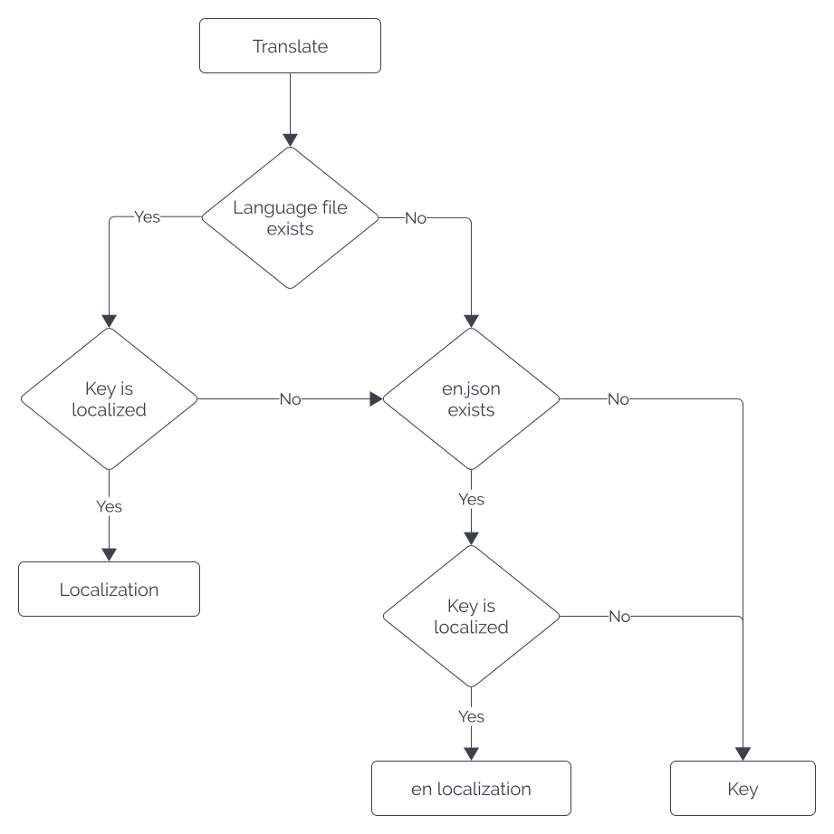

# Localization

The Stream Deck SDK supports localization, enabling you to build your plugin for a wider audience.

## Supported Languages

The following languages are supported by Stream Deck:

- Chinese (Simplified): zh_CN.json
- Chinese (Traditional): zh_TW.json<sup>1</sup>
- German: de.json
- English: en.json
- French: fr.json
- Japanese: ja.json
- Korean: ko.json
- Spanish: es.json

<sup>1</sup> Available from Stream Deck 6.8

Each of the supported languages' resources are stored in JSON files within the `*.sdPlugin` directory, and are named by their language code, like so:

```txt title="Plugin file structure" {8-13,15-16}
.
├── *.sdPlugin/
│   ├── bin/
│   ├── imgs/
│   ├── logs/
│   ├── ui/
│   │   └── increment-counter.html
|   ├── de.json
|   ├── en.json
|   ├── es.json
|   ├── fr.json
|   ├── ja.json
|   ├── ko.json
│   ├── manifest.json
|   ├── zh_CN.json
|   └── zh_TW.json
├── src/
│   ├── actions/
│   │   └── increment-counter.ts
│   └── plugin.ts
├── package.json
├── rollup.config.mjs
└── tsconfig.json
```

## Localized Resources

As part of localization, you can provide resources that:

- Override manifest strings that are displayed throughout Stream Deck, for example the action list.
- Custom localizations to be used within your plugin or property inspector.

<Warning>
  **Please note**

  Localizations are handled slightly differently in [sdpi-components](https://sdpi-components.dev/docs/helpers/localization), whereby property inspector resources are placed directly in the HTML file. This is subject to change in the future.
</Warning>

### Manifest Strings

Within the manifest, the following strings can be localized.

#### Root

- [`Name`](../references/manifest.md#manifest-name)
- [`Description`](../references/manifest.md#manifest-description)

#### `Actions`

- [`Name`](../references/manifest.md#action-name)
- [`Tooltip`](../references/manifest.md#action-tooltip)

#### `Actions[].Encoder.TriggerDescriptions`

- [`LongTouch`](../references/manifest.md#triggerdescriptions-longtouch)
- [`Push`](../references/manifest.md#triggerdescriptions-push)
- [`Rotate`](../references/manifest.md#triggerdescriptions-rotate)
- [`Touch`](../references/manifest.md#triggerdescriptions-touch)

#### `Actions[].States[]`

- [`Name`](../references/manifest.md#state-name)

#### Example

The following example demonstrates localizing the manifest strings, including strings associated with an action (indexed by the action's UUID), to German.

<!-- snippet: json/i18n/manifest.jsonc -->
```jsonc title="Example manifest for a volume controller plugin"
{
    // Some properties omitted for brevity...
    "Name": "Volume Controller",
    "Description": "Take control of your audio volume",
    "Actions": [
        {
            "UUID": "com.example.volume.adjust",
            "Name": "Volume control",
            "Tooltip": "Control your volume",
            "States": [
                {
                    "Name": "Unmute"
                },
                {
                    "Name": "Mute"
                }
            ],
            "Encoder": {
                "TriggerDescription": {
                    "LongTouch": "Mute",
                    "Push": "Toggle mute",
                    "Rotate": "Adjust",
                    "Touch": "Stummschaltung umschalten"
                }
            }
        }
    ]
}
```

<!-- snippet: json/i18n/de.jsonc -->
```json title="de.json, containing localizations for the aforementioned manifest example"
{
    "Name": "Lautstärkeregler",
    "Description": "Übernehmen Sie die Kontrolle über Ihre Audiolautstärke",
    "com.example.volume.adjust": {
        "Name": "Lautstärkeregelung",
        "Tooltip": "Kontrollieren Sie Ihre Lautstärke",
        "States": [
            {
                "Name": "Stummschaltung aufheben"
            },
            {
                "Name": "Stumm"
            }
        ],
        "Encoder": {
            "TriggerDescription": {
                "LongTouch": "Stumm",
                "Push": "Stummschaltung umschalten",
                "Rotate": "Anpassen",
                "Touch": "Stummschaltung umschalten"
            }
        }
    }
}
```

<Note>
  **Default values**

  If no localization file is provided, Stream Deck will use the values provided in the manifest JSON file. A language JSON file will override the manifest, even if the manifest provides text in said language, for example English.
</Note>

### Custom Strings

In addition to overriding manifest strings, you can provide custom localizations by defining a `Localization` object. The example below is an updated version of the `fr.json` example that includes custom strings.

<!-- snippet: json/i18n/de-custom.jsonc -->
```jsonc title="fr.json" {24-28}
{
    "Name": "Lautstärkeregler",
    "Description": "Übernehmen Sie die Kontrolle über Ihre Audiolautstärke",
    "com.example.volume.adjust": {
        "Name": "Lautstärkeregelung",
        "Tooltip": "Kontrollieren Sie Ihre Lautstärke",
        "States": [
            {
                "Name": "Stummschaltung aufheben"
            },
            {
                "Name": "Stumm"
            }
        ],
        "Encoder": {
            "TriggerDescription": {
                "LongTouch": "Stumm",
                "Push": "Stummschaltung umschalten",
                "Rotate": "Anpassen",
                "Touch": "Stummschaltung umschalten"
            }
        }
    },
    "Localization": {
        "More info": "Weitere Informationen",
        "Save": "Speichern",
        "Reset": "Zurücksetzen"
    }
}
```

Your custom strings can then be read using `streamDeck.i18n.translate` function.

<!-- snippet: node/guides/i18n.ts -->
```ts title="Reading custom localizations"
import streamDeck from "@elgato/streamdeck";

streamDeck.i18n.translate("More info");
// Output: "More info"

streamDeck.i18n.translate("More info", "de");
// Output: "Weitere Informationen"

streamDeck.i18n.translate("More info", "es");
// Output: "More info", es.json is not defined
```

When resolving custom localizations, the following order is applied.


