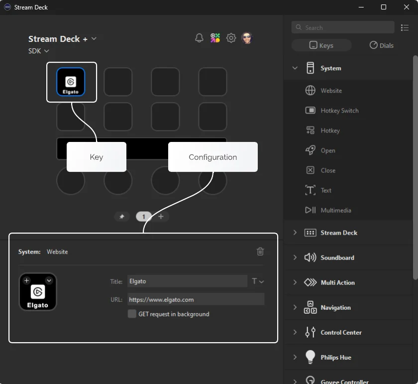
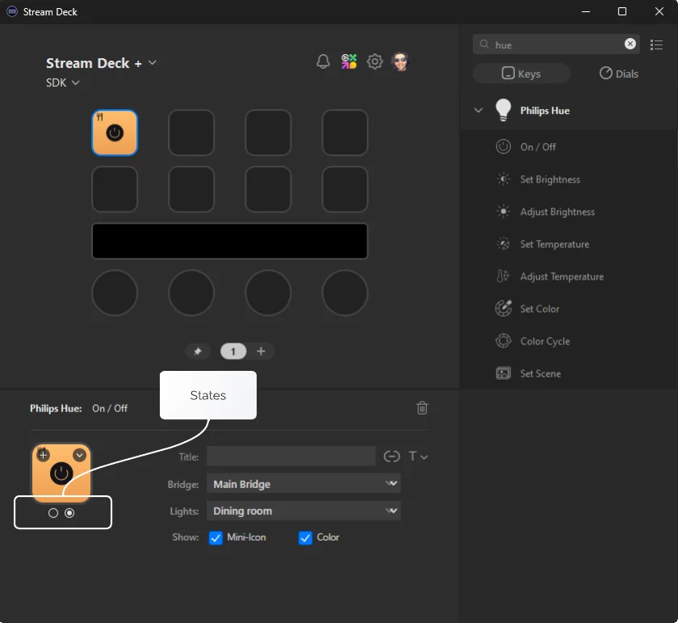
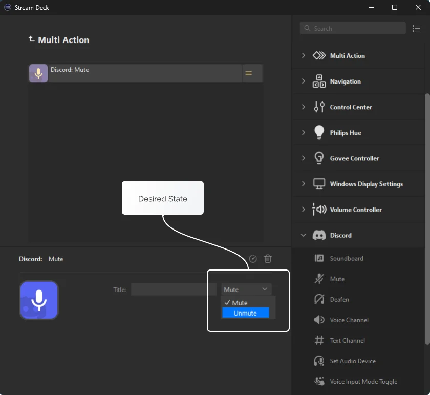
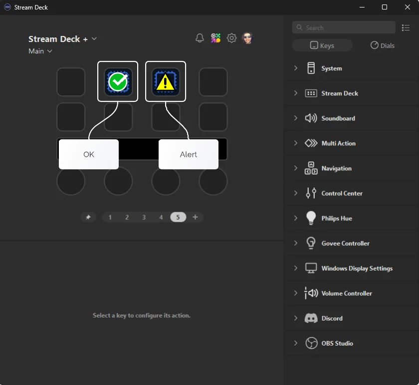

# Keys

One of the two primary types of actions available to Stream Deck plugins; keys are found on all Stream Deck devices, and allow users to activate your plugin's functionality.

## What Are Keys

Keys are your plugin's actions located on a Stream Deck canvas, for example on Stream Deck XL, Stream Deck Pedal, etc. They provide visual information to users in the form of a [title](#titles) and [image](#images), and can be activated by a user interacting with a physical Stream Deck device.



## States

The state of a key action, configured within the [manifest](../references/manifest.md#action-states), determines an action's behavior and defaults, for example the image shown on the canvas. All key actions must have at least one state, however they can have multiple states.

### Multi-State Keys

In cases where your key action represents toggle functionality, for example on/off or mute/un-mute, you can choose to configure two states within the manifest.

When supporting two states, the state is toggled when the user presses the key, with the new state index available via the payload information.

<Tip>
  **Automatic toggling**

  If you would prefer to control states yourself, you can also [opt out of automatic toggling](../references/manifest.md#action-disableautomaticstates) within the manifest.
</Tip>

Additionally, for action keys that support two states, users have the option of configuring will have the option to configure the icon for each state within Stream Deck:



<Warning>
  **Maximum number of states**

  Stream Deck supports up to two states; although adding more states is possible within the manifest, its functionality is not fully supported.
</Warning>

### States In Multi-Actions

When your action has multiple states, it's important to assign a [`Name`](../references/manifest.md#state-name) to each state, within the manifest. Doing so allows users to specify their desired state when using your action in a multi-action.

The following image shows the Discord "Mute" action which has two states, "Mute" and "Unmute".



The desired state can then be accessed, as the index (for example 0 or 1), within your plugin in the following way:

<!-- snippet: node/guides/actions/user-desired-state.ts -->
```ts title="Accessing the user desired state" {14}
import { action, KeyDownEvent, SingletonAction } from "@elgato/streamdeck";

/**
 * Example Discord Mute action.
 */
@action({ UUID: "com.discord.mute" })
export class Mute extends SingletonAction {
	/**
	 * Occurs when the user presses the key action.
	 */
	override onKeyDown(ev: KeyDownEvent) {
		if (ev.payload.isInMultiAction) {
			// We can access the user's desired state via...
			ev.payload.userDesiredState;
		}
	}
}
```

## Titles

All actions have a title; in the case of a key action, the title is rendered either at the top, middle, or bottom of the key, on-top of the image. Your plugin can define a [default title](../references/manifest.md#state-title) within the manifest, and update it using the [`setTitle`](#settitle) command[†](#display-precedence).

### Setting Titles

The follow example demonstrates updating the title an action on key down.

<!-- snippet: node/guides/actions/set-title.ts -->
```ts title="Setting action title" {12}
import { action, KeyDownEvent, SingletonAction } from "@elgato/streamdeck";

/**
 * Example action that updates the title.
 */
@action({ UUID: "com.elgato.hello-world.increment" })
export class IncrementCounter extends SingletonAction {
	/**
	 * Occurs when the user presses the key action.
	 */
	override onKeyDown(ev: KeyDownEvent) {
		ev.action.setTitle("Hello world!");
	}
}
```

You can also update the title on a more granular level using options.

<!-- snippet: node/guides/actions/set-title-with-options.ts -->
```ts title="Setting action title for specified state" {12-16}
import { action, KeyDownEvent, SingletonAction, Target } from "@elgato/streamdeck";

/**
 * Example action that updates the title.
 */
@action({ UUID: "com.elgato.hello-world.increment" })
export class IncrementCounter extends SingletonAction {
	/**
	 * Occurs when the user presses the key action.
	 */
	override onKeyDown(ev: KeyDownEvent) {
		ev.action.setTitle("Hello world!", {
			state: 0,
			target: Target.Hardware,
		});
	}
}
```

### User Changes

Your plugin can monitor for changes the user makes to the title using the [`onTitleParameterDidChange`](./actions.md#ontitleparametersdidchange) event.

## Images

Your plugin can update an action key's image[†](#display-precedence) using the [`setImage`](#setimage) command. The `setImage` function accepts a path to an image file or an [image data URL](https://developer.mozilla.org/en-US/docs/Web/HTTP/Basics_of_HTTP/Data_URLs) with base64 encoded data. Stream Deck supports multiple image formats:

- SVG - `image/svg+xml` (recommended).
- JPG/JPEG - `image/jpeg`
- PNG - `image/png`
- WEBP - `image/webp`

<Warning>
  **Animated image formats**

  The `setImage` function does not support animated image formats, such as GIF.
</Warning>

### From SVG

The image of a key action be be updated using an encoded SVG string, and is useful if your plugin needs to customize the image before rendering.

<!-- snippet: node/guides/actions/set-image-svg.ts -->
```ts title="Setting action image using a dynamic SVG" {18}
import { action, KeyDownEvent, SingletonAction } from "@elgato/streamdeck";

/**
 * Example action that updates the key action image from an SVG on key press.
 */
@action({ UUID: "com.elgato.hello-world.increment" })
export class IncrementCounter extends SingletonAction {
	/**
	 * Occurs when the user presses the key action.
	 */
	override onKeyDown(ev: KeyDownEvent<CounterSettings>) {
		const { count } = ev.payload.settings;
		const isRed = count % 2 === 0;
		const svg = `<svg width="100" height="100">
						<circle fill="${isRed ? "red" : "blue"}" r="45" cx="50" cy="50" ></circle>
					</svg>`;

		ev.action.setImage(`data:image/svg+xml,${encodeURIComponent(svg)}`);
		ev.action.setSettings({ count: count + 1 });
	}
}

type CounterSettings = {
	count: number;
};
```

### From Data URL

The image of a key action can be updated using an [image data URL](https://developer.mozilla.org/en-US/docs/Web/HTTP/Basics_of_HTTP/Data_URLs) with a multitude of [MIME types](https://developer.mozilla.org/en-US/docs/Web/HTTP/Basics_of_HTTP/MIME_types#image_types) and base64 encoded data.

<!-- snippet: node/guides/actions/set-image-data.ts -->
```ts title="Setting action image using image data URL" {12-16}
import { action, KeyDownEvent, SingletonAction } from "@elgato/streamdeck";

/**
 * Example action that updates the key action image from a data URL on key press.
 */
@action({ UUID: "com.elgato.hello-world.increment" })
export class IncrementCounter extends SingletonAction {
	/**
	 * Occurs when the user presses the key action.
	 */
	override onKeyDown(ev: KeyDownEvent) {
		ev.action.setImage(
			// base64 data URL
			"data:image/png;base64,iVBORw0KGgoAAAANSUhEUgAAAEgAAABICAIAAADajyQQAAAFF2lUWHRYTUw6Y29tLmFkb2JlLnhtcAAAAAAAPD94cGFja2V0IGJlZ2luPSLvu78iIGlkPSJXNU0wTXBDZWhpSHpyZVN6TlRjemtjOWQiPz4KPHg6eG1wbWV0YSB4bWxuczp4PSJhZG9iZTpuczptZXRhLyIgeDp4bXB0az0iWE1QIENvcmUgNS41LjAiPgogPHJkZjpSREYgeG1sbnM6cmRmPSJodHRwOi8vd3d3LnczLm9yZy8xOTk5LzAyLzIyLXJkZi1zeW50YXgtbnMjIj4KICA8cmRmOkRlc2NyaXB0aW9uIHJkZjphYm91dD0iIgogICAgeG1sbnM6eG1wPSJodHRwOi8vbnMuYWRvYmUuY29tL3hhcC8xLjAvIgogICAgeG1sbnM6cGhvdG9zaG9wPSJodHRwOi8vbnMuYWRvYmUuY29tL3Bob3Rvc2hvcC8xLjAvIgogICAgeG1sbnM6ZXhpZj0iaHR0cDovL25zLmFkb2JlLmNvbS9leGlmLzEuMC8iCiAgICB4bWxuczp0aWZmPSJodHRwOi8vbnMuYWRvYmUuY29tL3RpZmYvMS4wLyIKICAgIHhtbG5zOnhtcE1NPSJodHRwOi8vbnMuYWRvYmUuY29tL3hhcC8xLjAvbW0vIgogICAgeG1sbnM6c3RFdnQ9Imh0dHA6Ly9ucy5hZG9iZS5jb20veGFwLzEuMC9zVHlwZS9SZXNvdXJjZUV2ZW50IyIKICAgeG1wOkNyZWF0ZURhdGU9IjIwMjQtMDgtMTNUMTU6MDA6MTUtMDQwMCIKICAgeG1wOk1vZGlmeURhdGU9IjIwMjQtMDgtMTNUMTU6MDE6NTMtMDQ6MDAiCiAgIHhtcDpNZXRhZGF0YURhdGU9IjIwMjQtMDgtMTNUMTU6MDE6NTMtMDQ6MDAiCiAgIHBob3Rvc2hvcDpEYXRlQ3JlYXRlZD0iMjAyNC0wOC0xM1QxNTowMDoxNS0wNDAwIgogICBwaG90b3Nob3A6Q29sb3JNb2RlPSIzIgogICBwaG90b3Nob3A6SUNDUHJvZmlsZT0ic1JHQiBJRUM2MTk2Ni0yLjEiCiAgIGV4aWY6UGl4ZWxYRGltZW5zaW9uPSI3MiIKICAgZXhpZjpQaXhlbFlEaW1lbnNpb249IjcyIgogICBleGlmOkNvbG9yU3BhY2U9IjEiCiAgIHRpZmY6SW1hZ2VXaWR0aD0iNzIiCiAgIHRpZmY6SW1hZ2VMZW5ndGg9IjcyIgogICB0aWZmOlJlc29sdXRpb25Vbml0PSIyIgogICB0aWZmOlhSZXNvbHV0aW9uPSIzMDAvMSIKICAgdGlmZjpZUmVzb2x1dGlvbj0iMzAwLzEiPgogICA8eG1wTU06SGlzdG9yeT4KICAgIDxyZGY6U2VxPgogICAgIDxyZGY6bGkKICAgICAgc3RFdnQ6YWN0aW9uPSJwcm9kdWNlZCIKICAgICAgc3RFdnQ6c29mdHdhcmVBZ2VudD0iQWZmaW5pdHkgRGVzaWduZXIgMiAyLjUuMyIKICAgICAgc3RFdnQ6d2hlbj0iMjAyNC0wOC0xM1QxNTowMTo1My0wNDowMCIvPgogICAgPC9yZGY6U2VxPgogICA8L3htcE1NOkhpc3Rvcnk+CiAgPC9yZGY6RGVzY3JpcHRpb24+CiA8L3JkZjpSREY+CjwveDp4bXBtZXRhPgo8P3hwYWNrZXQgZW5kPSJyIj8+xLBe4AAAAYFpQ0NQc1JHQiBJRUM2MTk2Ni0yLjEAACiRdZHLS0JBFIc/tUhKK6pFixYS1sqiB0htgpSwQELMIKuN3nwEPi73KiFtg7ZCQdSm16L+gtoGrYOgKIJo7bqoTcXt3AyMyBnOOd/8Zs5h5gxYIxklqzcMQTZX0MIBn2shuuhqqmDHSYdYa0zR1clQKEjd8XaHxYw3A2at+uf+HS0rCV0Bi114QlG1gvC0cHCtoJq8LdylpGMrwqfCHk0uKHxr6vEqV0xOVfnDZC0S9oO1XdiV+sXxX6yktaywvBx3NlNUfu5jvsSRyM3PSewV60EnTAAfLmaYwo+XYcbFexlghEFZUSd/6Dt/lrzkKuJVSmiskiJNAY+oRamekJgUPSEzQ8ns/9++6snRkWp1hw8anwzjpQ+atuCzbBjvh4bxeQS2R7jI1fLzBzD2Knq5prn3oW0Dzi5rWnwHzjeh+0GNabFvySZmTSbh+QScUei8hualas9+9jm+h8i6fNUV7O5Bv5xvW/4CDa5nvRjbKwoAAAAJcEhZcwAALiMAAC4jAXilP3YAAABvSURBVGiB7c8BDcAgAMAwwBzK0M1VPM+eVsE279njj9bXAW8xVmOsxliNsRpjNcZqjNUYqzFWY6zGWI2xGmM1xmqM1RirMVZjrMZYjbEaYzXGaozVGKsxVmOsxliNsRpjNcZqjNUYqzFWY6zGWM0D2SQCW/zbGkwAAAAASUVORK5CYII=",
		);
	}
}
```

### From File

You can update the image of a key action directly from a file located on disk.

<!-- snippet: node/guides/actions/set-image-file.ts -->
```ts title="Setting action image using image path" {12-13}
import { action, KeyDownEvent, SingletonAction } from "@elgato/streamdeck";

/**
 * Example action that updates the key action image from a file.
 */
@action({ UUID: "com.elgato.hello-world.increment" })
export class IncrementCounter extends SingletonAction {
	/**
	 * Occurs when the user presses the key action.
	 */
	override onKeyDown(ev: KeyDownEvent) {
		ev.action.setImage("imgs/actions/counter/key.png"); // image path
	}
}
```

### Options

You can also provide optional `ImageOptions` to specify a `Target` (hardware, software, or both) and a state (0 or 1), when updating images of an action key.

<!-- snippet: node/guides/actions/set-image-with-options.ts -->
```ts title="Setting action image with specified target options" {12-16}
import { action, KeyDownEvent, SingletonAction, Target } from "@elgato/streamdeck";

/**
 * Example action that updates the key action image with additional options.
 */
@action({ UUID: "com.elgato.hello-world.increment" })
export class IncrementCounter extends SingletonAction {
	/**
	 * Occurs when the user presses the key action.
	 */
	override onKeyDown(ev: KeyDownEvent) {
		ev.action.setImage("imgs/actions/counter/key.png", {
			target: Target.HardwareAndSoftware,
			state: 1,
		});
	}
}
```

## Display Precedence

When rendering an action key's title and image, a specific order precedence is followed, thus determining what is rendered on the key.

The following list defines the precedence, with the first item being the highest priority, and last being the lowest priority:

1. User defined titles and/or images.
2. Titles and/or images set at runtime using `setTitle`/`setImage`.
3. Default titles and/or images defined within the manifest.

## Temporary Feedback

There may be times when you want to show user temporary feedback on a key, for example when an action succeeds or fails. To achieve this, you can use the [`showOk`](#showok) and [`showAlert`](#showalert) functions on the `action`.



<Tip>
  It is best practice to accompany `showAlert` with a [log entry](./logging.md) to help diagnose what caused the warning.
</Tip>

## Events

In addition to the [action events](./actions.md#events) found on both keys and dials, keys also receive the following events in the form of overridable methods on the `SingletonAction` class.

### onKeyDown

Occurs when the user presses a action down. See also `SingletonAction.onKeyUp`.

NB: For dials / touchscreens see `SingletonAction.onDialDown`.

```ts
function onKeyDown(ev: KeyDownEvent): void | Promise<void>
```

**Parameters**

| Name | Type | Description |
| --- | --- | --- |
| `ev` | `KeyDownEvent` | Information about the event, including the source action and contextual payload information. |

### onKeyUp

Occurs when the user releases a pressed action. See also `SingletonAction.onKeyDown`.

NB: For dials / touchscreens see `SingletonAction.onDialUp`.

```ts
function onKeyUp(ev: KeyUpEvent): void | Promise<void>
```

**Parameters**

| Name | Type | Description |
| --- | --- | --- |
| `ev` | `KeyUpEvent` | Information about the event, including the source action and contextual payload information. |

## Commands

The following commands are available to key actions.

<Tip>
  Some events are applicable to both dials and keys, such as [`onWillAppear`](./actions.md#onwillappear). To invoke a key-only command within these event handlers, you need to first assert the action is a key using [`Action.isKey()`](./actions.md#iskey).
</Tip>

### getResources

Gets the resources (files) associated with this action; these resources are embedded into the
action when it is exported, either individually, or as part of a profile.

Available from Stream Deck 7.1.

```ts
function getResources(): Promise<Resources>
```

### getSettings

Gets the settings associated this action instance.

```ts
function getSettings<U extends JsonObject>(): Promise<U>
```

### setImage

Sets the `image` to be display for this action instance.

NB: The image can only be set by the plugin when the the user has not specified a custom image.

```ts
function setImage(image?: string, options?: ImageOptions): Promise<void>
```

**Parameters**

| Name | Type | Description |
| --- | --- | --- |
| `image` | `string` (optional) | Image to display; this can be either a path to a local file within the plugin's folder, a base64 encoded `string` with the mime type declared (e.g. PNG, JPEG, etc.), or an SVG `string`. When `undefined`, the image from the manifest will be used. |
| `options` | `ImageOptions` (optional) | Additional options that define where and how the image should be rendered. |

### setResources

Sets the resources (files) associated with this action; these resources are embedded into the
action when it is exported, either individually, or as part of a profile.

Available from Stream Deck 7.1.

```ts
function setResources(resources: Resources): Promise<void>
```

**Parameters**

| Name | Type | Description |
| --- | --- | --- |
| `resources` | `Resources` | The resources as a map of file paths. |

### setSettings

Sets the settings associated with this action instance. Use in conjunction with `Action.getSettings`.

```ts
function setSettings<U extends JsonObject>(value: U): Promise<void>
```

**Parameters**

| Name | Type | Description |
| --- | --- | --- |
| `value` | `U` | Settings to persist. |

### setState

Sets the current `state` of this action instance; only applies to actions that have multiple states defined within the manifest.

```ts
function setState(state: number): Promise<void>
```

**Parameters**

| Name | Type | Description |
| --- | --- | --- |
| `state` | `number` | State to set; this be either 0, or 1. |

### setTitle

Sets the `title` displayed for this action instance.

NB: The title can only be set by the plugin when the the user has not specified a custom title.

```ts
function setTitle(title?: string, options?: TitleOptions): Promise<void>
```

**Parameters**

| Name | Type | Description |
| --- | --- | --- |
| `title` | `string` (optional) | Title to display; when `undefined` the title within the manifest will be used. |
| `options` | `TitleOptions` (optional) | Additional options that define where and how the title should be rendered. |

### showAlert

Temporarily shows an alert (i.e. warning), in the form of an exclamation mark in a yellow triangle, on this action instance. Used to provide visual feedback when an action failed.

```ts
function showAlert(): Promise<void>
```

### showOk

Temporarily shows an "OK" (i.e. success), in the form of a check-mark in a green circle, on this action instance. Used to provide visual feedback when an action successfully
executed.

```ts
function showOk(): Promise<void>
```
