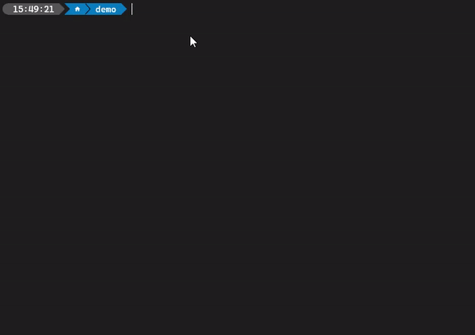
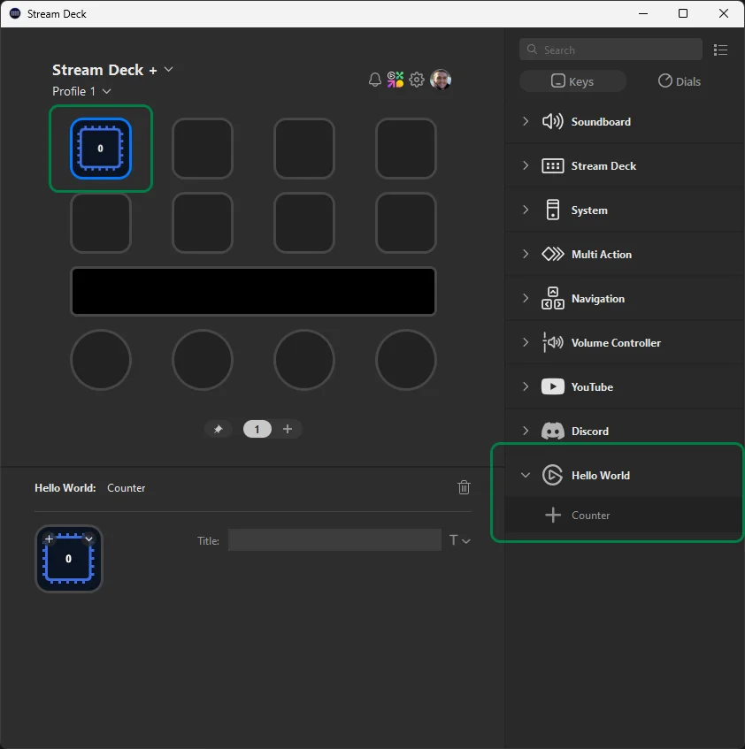

# Getting Started

In this article you'll learn how to setup your development environment, create your first Stream Deck plugin, and test your plugin in Stream Deck.

## Installation

### Prerequisites

Developing plugins with the Stream Deck SDK requires:

- [Node.js](https://nodejs.org/en/download/package-manager) version 24 or higher.
- [Stream Deck](https://www.elgato.com/s/downloads?product=Stream%20Deck) version 7.1 or higher.
- Stream Deck device.
- Text editor, [VS Code](https://code.visualstudio.com/) is recommended.
- Terminal for accessing the Stream Deck command line interface (CLI).

<details>
<summary>Learn more about installing Node.js.</summary>

Installing Node.js is best achieved with a Node version manager, such as:

- [nvm](https://github.com/nvm-sh/nvm?tab=readme-ov-file#installing-and-updating) for macOS
- [nvm-windows](https://github.com/coreybutler/nvm-windows/releases) for Windows

With one of the aforementioned nvm(-windows) installed, run the following commands:

1. Install Node.js:

   ```bash
   nvm install 24
   ```

2. Switch to the installed version of Node.js:

   ```bash
   nvm use 24
   ```

3. Restart your terminal and verify the version of Node.js is at least version 24:

   ```bash
   node -v
   ```

> [!NOTE]
> For more information on installing Node.js on Windows, we recommend Microsoft's how-to [Install Node.js on Windows](https://learn.microsoft.com/en-us/windows/dev-environment/javascript/nodejs-on-windows#install-nvm-windows-nodejs-and-npm), or Node.js' [download page](https://nodejs.org/en/download/package-manager).

</details>

> [!TIP]
> **Stream Deck**
>
> If you do not own a Stream Deck device, you can try [Stream Deck Mobile](https://www.elgato.com/stream-deck-mobile) for free.

### Setup Wizard

The Stream Deck SDK is supported by a CLI, called the [Stream Deck CLI](https://docs.elgato.com/streamdeck/cli/intro). As part of the Stream Deck CLI, there is a command line plugin creation wizard for easily scaffolding a basic Stream Deck plugin.

First, install the Stream Deck CLI by running the following command.

<Tabs>
<TabItem value="npm" label="npm" default>

```bash
npm install -g @elgato/cli
```

</TabItem>
<TabItem value="yarn" label="yarn">

```bash
yarn global add @elgato/cli
```

</TabItem>
<TabItem value="pnpm" label="pnpm">

```bash
pnpm add -g @elgato/cli
```

</TabItem>
</Tabs>

<details>
<summary>PowerShell on Windows</summary>

Node.js CLIs include a local `.ps1` PowerShell script that requires an execution policy to run. If an execution policy is not yet configured, you can set one using [`Set-ExecutionPolicy`](https://learn.microsoft.com/en-us/powershell/module/microsoft.powershell.security/set-executionpolicy), for example:

```bash title="Set PowerShell's execution policy"
Set-ExecutionPolicy -ExecutionPolicy RemoteSigned -Scope CurrentUser
```

</details>

Then, run the [`create`](https://docs.elgato.com/streamdeck/cli/commands/create) command:

```bash
streamdeck create
```



> [!WARNING]
> **Plugin UUID**
>
> Your plugin's UUID is a [reverse-DNS](https://en.wikipedia.org/wiki/Reverse_domain_name_notation) format string, unique to your plugin, that reflects your organization and the product your plugin is intended for, for example:
>
> - com.obsproject.obs-studio
> - com.youtube.live
> - tv.twitch.studio
>
> Plugin UUIDs must only contain lowercase alphanumeric characters (`a-z`, `0-9`), hyphens (`-`), and periods (`.`). Once published on Marketplace, your plugin's UUID cannot be changed.

## File Structure

After completing the plugin creation wizard there will be a new directory, with the name of your plugin, that contains:

```text title="Plugin file structure"
.
├── *.sdPlugin/
│   ├── bin/
│   ├── imgs/
│   ├── logs/
│   ├── ui/
│   │   └── increment-counter.html
│   └── manifest.json
├── src/
│   ├── actions/
│   │   └── increment-counter.ts
│   └── plugin.ts
├── package.json
├── rollup.config.mjs
└── tsconfig.json
```

### .sdPlugin

The `./*.sdPlugin` directory _is_ your compiled plugin, and contains:

- `bin`, compiled output files from your [`./src`](#src) directory.
- `imgs`, supporting images distributed with your plugin.
- `logs`, logs generated with a [logger](../guides//logging.md).
- `ui`, [property inspectors](../guides/ui.md), allowing users to configure actions in Stream Deck.
- `manifest.json`, that defines the metadata of your plugin, [learn more about the manifest](../references/manifest.md).

### src

The `./src` directory contains the source file for your Stream Deck plugin and is configured to a Node.js environment. As part of the scaffolded plugin, the directory contains:

- `index.ts`, the entry point of your plugin.
- `actions/increment-counter.ts`, an example action that displays a count.

## Running Your Plugin

In addition to your plugin files, the setup wizard will have pre-populated npm scripts in `package.json` to assist with building and developing your plugin:

```jsonc title="Scripts provided in package JSON file"
{
	"scripts": {
		"build": "rollup -c",
		"watch": "rollup -c -w --watch.onEnd=\"streamdeck restart {{YOUR_PLUGIN_UUID}}\"",
	},
	// ...
}
```

To start developing your plugin, run the following command:

```bash
npm run watch
```

You should now see your plugin in Stream Deck.



Whilst running the `npm run watch` command, any changes you make to `./*.sdPlugin/manifest.json` or `./src` will automatically be reflected in Stream Deck. To stop watching for changes, press <kbd>Ctrl</kbd> + <kbd>C</kbd>.

Congratulations, you've just created your first Stream Deck plugin! 🎉

> [!TIP]
> **Plugin not showing in Stream Deck**
>
> If your plugin is not showing within Stream Deck, this may be due to the app running with elevated privileges. This occurs after a fresh install, or update, of the Stream Deck app; restarting the app should resolve the issue. For further help, our community [Marketplace Makers Discord](https://discord.gg/GehBUcu627) is also available.

## What's Next?

- Make [your first changes](./your-first-changes.md).
- Learn more about [actions](../guides/actions.md) and how you can expand your plugin's functionality.
- Discover [property inspectors](../guides/ui.md), allowing users to configure your plugin in Stream Deck.
- Explore more commands available within the [Stream Deck CLI](https://docs.elgato.com/streamdeck/cli/intro).
